# QUARTZ

QUARTZ is a four-track groovebox for the M-VAVE FM-1. This manual starts with the controls and a first beat, then
goes through each page: the sounds, how to shape them, the sequencer, the pattern sources and the global settings.

---

## Contents

1. Overview
2. Install
3. The FM-1 at a glance
4. Quick start
5. Tracks, patterns and song
6. Sound
7. Shaping
8. Sequencer
9. Sources
10. Global
11. Saving
12. Credits and inspirations
13. Troubleshooting

---

## Pages

Pages of their own, beside this manual:

- [Sequencer](sequencer.html): writing and recording STEP patterns, p-locks, REC held, random draws.
- Models, by family: [Analog](synth-analog.html) · [FM](synth-fm.html) · [Tables](synth-tables.html) · [Spectral](synth-spectral.html) · [Chords](synth-chords.html) · [Voice](synth-voice.html) · [Noise](synth-noise.html) · [Physical](synth-physical.html) · [Drums](synth-drums.html).
- Sources: [STEP](sequencer.html) · [ATLAS](source-atlas.html) · [FLEET](source-fleet.html) · [COLONY](source-colony.html) · [LOOM](source-loom.html) · [CADENCE](source-cadence.html) · [LATTICE](source-lattice.html) · [MOONS](source-moons.html) · [IMPROV](source-improv.html) · [CIPHER](source-cipher.html).

---

## 1. Overview

QUARTZ has four tracks. Each track has a sound, which is one of 24 models (21 synths and 3 drums) or a kit of 16
drum pads, and eight patterns. A pattern takes its notes from a source: STEP is a step sequencer you write yourself, and the nine
others generate notes as they play (section 9). You can always play the current track on the keys, whatever its
source.

Everything is reached with one button and a few pages, with no menus. A button opens a *domain* (EDIT, SEQ, GLO,
HOME, ENV, LFO, ARP, FX), SELECT turns its pages, and the four knobs K1–K4 set what the page shows. Most pages show
an animated *scene* that moves with the sound and with every knob.

| Word | Meaning |
| --- | --- |
| Track | One of the four parts, 1–4. ALGORITHM picks the current one. |
| Sound | What a track sounds like: a model (EDIT) shaped by ENV, LFO, ARP and FX. |
| Pattern | P1–P8, eight per track. A track plays one pattern at a time. |
| Source | Where a pattern's notes come from: STEP, ATLAS, FLEET, COLONY, LOOM, CADENCE, LATTICE, MOONS, IMPROV or CIPHER. |
| Step | One of a STEP pattern's 64 places, 16 per page of the grid. |
| P-lock | A knob's value stored on a single step. |
| Scene | The four patterns playing and the mutes, kept together. Eight per project. |
| Song | A list of scenes, each played a number of times. |
| Project | Everything above, the tempo, the scale and the effects. QUARTZ keeps four projects (section 11). |

**Inspired by** the [OP-Z](https://teenage.engineering/guides/op-z) by teenage engineering: one button per domain,
held buttons that turn the keys into shortcuts, punch-in effects, and the shape of this guide. The scenes' look, flat
low-poly shapes and neon wireframes over a dark grid, is inspired by [Rez](https://en.wikipedia.org/wiki/Rez_%28video_game%29)
(United Game Artists, 2001).

---

## 2. Install

To try QUARTZ first, open the emulator. It runs the same code in your browser, with sound, and you can play it with a
mouse, a touch screen or your computer keyboard.

To install it from the browser, use Chrome or Edge. Connect the FM-1 by USB, open the installer and press Install.
The browser asks once to allow MIDI, so allow it. Don't unplug the cable while it writes.

To install it from a terminal, use fm1-base's installer: `python3 tools/fm1_install.py quartz-VERSION.fwsc`. If the
install stops early, add `--classic` and run it again: it resumes where it stopped.

To go back to the stock firmware, use the installer's last section, which writes M-VAVE's own firmware back.

At power-on, a quartz crystal lights up facet by facet while QUARTZ loads the project, then the voices, then the
screen.

> An update can change how projects are saved. While QUARTZ is still young, the project saved by an older version
> is then not loaded, and you start from a new project, and its backups don't restore either (section 11). Note down
> anything you want to keep. The projects saved by 0.9 load in this version; their backups don't restore.

---

## 3. The FM-1 at a glance

### Knobs

| Knob | What it does |
| --- | --- |
| MASTER | The volume. |
| SELECT | Turns the pages of the domain shown. On a held step, it turns the step's p-lock pages. |
| ALGORITHM | Picks the track, 1–4. |
| PRESET | Browses what the page is about: the model on EDIT, the pattern on SEQ (or what the source uses it for, section 9), the insert's type on INSERT, FREE or TRIG on LFO, the entry on SONG. |
| K1–K4 | Set the four values at the bottom of the screen, in their colours: blue, green, white, orange. |

### Buttons

| Button | Short press | Held |
| --- | --- | --- |
| EDIT | The sound: ENGINE, SOUND (a kit: PAD, KIT). | — |
| ENV | The envelope and the filter: ADSR, FILTER. | — |
| LFO | The two LFOs: LFO, LFO 2. | — |
| ARP | The arpeggiator. | The notes you press stay in the arpeggio after you let go (latch). |
| FX | The track's effects: MIX, INSERT. | The white keys are the 16 punch-ins; black key 1 is FILL. |
| SEQ | The pattern: STEPS, then its source's pages. | White keys 1–8 pick the track's pattern; black keys 1–4 copy and paste. |
| GLO | The project: TEMPO, SCALE, KEYS, FX, CPU. | Black key 1 taps the tempo (section 10). |
| HOME | The four tracks and the song: TRACKS, SONG. | White keys 1–4 mute the tracks, 9–16 are the scenes. |
| SAVE | Saves the project (while playing: at the stop). | White keys 1–8 add a scene to the song; black key 1 twice starts a new project; black keys 2–5 twice load project 1–4. |
| SEL | On SONG, removes the entry shown. | Selects steps on the grid ([Sequencer](sequencer.html#several-steps-at-once)). |
| PLAY | Starts or stops every track. | — |
| REC | Arms the recording ([Sequencer](sequencer.html#playing-writing-recording)). | Black key 1 clears the pattern, black key 2 its p-locks, black keys 6–8 draw at random ([Sequencer](sequencer.html#random)). With PLAY: records live. |
| OCT- / OCT+ | The keyboard's octave, −2 to +2. On the grid: the page of steps. | — |

A short press is a press released before 0.4 s with nothing else pressed meanwhile. A button held longer does not do
its own action when you let it go.

### Keys

The 27 keys start on F. Unless a page gives them another role, they play the current track: the notes of a synth
model, or the 16 pads of a kit on the white keys. The black keys are numbered 1–11 and the white keys 1–16 from the
left, as the screen numbers them.

### The screen

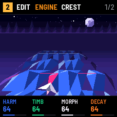

- **Header**: the track in a box (an orange `*` beside it: something changed since the last SAVE), the domain and the page (on ENGINE and SOUND, the model too; on SEQ, the pattern: `P1 > P2` while the next one waits
  for the end of the loop), the page's number, and REC's state when it is armed (GRID, NOTES, LIVE; ARM and LISTEN
  blink).
- **Scene**: what the page sets, animated. It reacts to every knob of the page and to each note played, in pink.
- **Footer**: K1–K4, their names and values in their colours. A grey one is not in use on this page.

Messages show in the header for a moment: `SAVE AT STOP` (SAVE while playing), `LOCKS FULL` (no room for another
p-lock in the pattern), `AGAIN: ERASE` (press again to start a new project), `AGAIN: PASTE` (press again to paste),
`AGAIN: LOAD`, `UNSAVED: LOAD?` and `PROJECT 2` (section 11), `PATTERN COPIED` and the other copies' (section 5), `UNDONE` and `REDONE`
(REC held, black key 3), `TAP 120` (the tempo just tapped), or the name of a punch-in.

### Held buttons show their map

Hold HOME, FX, SAVE, SEQ, ARP, SEL, REC or GLO for more than 0.4 s: the scene makes room for a map of the keys. The keys
that have a role are lit and named, and the combinations with other buttons are listed under them. The map follows
your presses, so you can look up a shortcut and use it in the same gesture.

---

## 4. Quick start

A kick on track 1 and a melody on track 2, from a new project.

1. Press EDIT, then turn PRESET to the end, to the kit: the header says `PAD 1` and the scene shows the kit's three
   drums.
2. Press SEQ, then REC once. The header shows `GRID`: the white keys are now the 16 steps.
3. Press white keys 1, 5, 9 and 13. Each one becomes a step with the bass drum (pad 1).
4. Press PLAY. The kick plays four on the floor; the white keys light as the steps pass.
5. Turn ALGORITHM one notch to track 2, then press REC once more. The header shows `NOTES 1`: whatever you play is
   written at the cursor, which then moves on.
6. Play four notes. They fill steps 1 to 4, and you hear them as the loop comes round.
7. Press REC to disarm. Now try the knobs on EDIT, ENV and FX, or turn SEQ's SOURCE to another source.

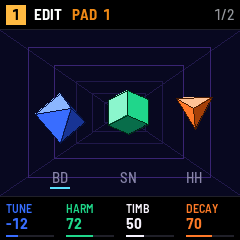

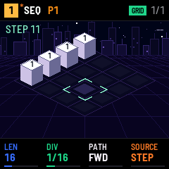

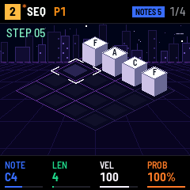

---

## 5. Tracks, patterns and song

### Tracks

ALGORITHM picks the current track: the keys play it and the pages set it. HOME's TRACKS page shows the four tracks
on their pedestals, with the pattern each plays and its model, and its knobs are a mixer.

| Page | K1 | K2 | K3 | K4 |
| --- | --- | --- | --- | --- |
| TRACKS | LVL 1: track 1's level, 0–127 | LVL 2 | LVL 3 | LVL 4 |

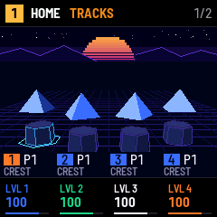

To mute a track, hold HOME and press white key 1–4. A muted track's pedestal goes dark and its key goes out.

To solo a track, hold HOME and SEL and press its white key 1–4: the other three are muted. The same keys again put the
mutes back as they were; another track's key solos that one instead. The solo is made of mutes: a scene stored
meanwhile keeps it, and muting a track by hand ends it, leaving the mutes as they are.

### Patterns

Each track has eight patterns, P1–P8. To pick one, hold SEQ and press white key 1–8, or turn PRESET on a STEP
pattern's pages. While playing, the new pattern starts when the one playing reaches the end of its loop; the header
shows `P1 > P2` meanwhile. Hold SEL too (SEQ, SEL and the white key) and it starts at the next step, at the same
place in the bar.

The tracks count their steps from PLAY: a pattern plays the step it would have reached had it played since PLAY, as
after a STOP and a PLAY. A length changed then put back, a pattern changed then picked again: the track is back in
step with the others. Two lengths, 16 against 7, still make a polyrhythm, counted from PLAY (or from the last scene
launched). A pattern of 32 steps picked at the end of a 16-step loop in the second bar starts at its step 17.

To clear the pattern shown, hold REC and press black key 1. To remove only its p-locks, hold REC and press black key 2.
Hold REC and press black key 3 to undo either ([REC held](sequencer.html#rec-held)).

To copy a pattern, hold SEQ and press black key 1 (`PATTERN COPIED`): its steps, p-locks, LEN, DIV, PATH and the
settings of every source. Then pick where it goes, another pattern or another track, hold SEQ and press black key 2
twice: the first press asks (`AGAIN: PASTE`), the second replaces the pattern shown. A pattern with chords pasted on a
synth track sets its POLY to 3 at least, as SOURCE does.

The same way, black key 3 copies the track's sound: its model, its EDIT, ENV, LFO and ARP settings, its insert, sends,
pan and level, and on a KIT its 16 pads. Black key 4, pressed twice, pastes it on the track shown. What you copied
stays until you turn the FM-1 off. REC held and black key 3 undoes a paste.

To start the track's sound over, hold SEQ and press black key 8 twice (`AGAIN: INIT`, then `SOUND INIT`): every
setting goes back to a new project's, but the model stays (a KIT keeps its 16 pads, as the default kit). REC held and
black key 3 undoes it.

To double a STEP pattern, hold SEQ and press black key 6 (`LEN DOUBLED`): LEN 16 becomes 32, and steps 1–16 with
their p-locks are copied onto steps 17–32, ready for a variation on the second half. A pattern longer than 32 steps
says `TOO LONG TO DOUBLE`, and one whose p-locks would not fit `LOCKS FULL`. REC held and black key 3 undoes it.

To keep what a generative source plays, PRINT it: while playing, hold SEQ and press black key 5 twice (`AGAIN: PRINT`,
then `PRINTING`). The next loop the pattern plays is written into its steps as it goes, then the pattern becomes STEP
(`PRINTED`): its LEN the loop's, PATH FWD, ready to edit by hand, p-locks and conditions included. A note accented in
the loop accents its whole step. Stopping before the loop is over prints nothing; REC held and black key 3 gives the
source back.

### Scenes

A scene keeps the pattern of each track and the mutes. Hold HOME and press white key 9–16 for scene 1–8:

- an empty scene stores what plays now;
- a stored scene comes back at once when stopped, and at the next bar while playing (the header shows `SCENE n`
  until then);
- with SEL held too, the scene is stored again over the old one.

The keys 9–16 are lit on HOME for the scenes in use.

### Song

The song is a list of up to 32 entries, each a scene played a number of times. Hold SAVE and press white key 1–8 to
add that scene at the end of the song. Then set it on HOME's SONG page:

| Knob | What it does | Range |
| --- | --- | --- |
| PRESET or K1 ENTRY | The entry shown. | 1 – the number of entries |
| K2 SCENE | The scene the entry plays. | 1–8 |
| K3 REPEAT | How many times it plays. | 1–16 |
| K4 MODE | PATTERN: PLAY starts the patterns as they are. SONG: PLAY starts at the first entry and goes through the list, then loops. | PATTERN, SONG |

An entry lasts its REPEAT times the length of its longest pattern, rounded up to whole bars. Press SEL on the SONG page
to remove the entry shown.

### New project

Hold SAVE and press black key 1: the header says `AGAIN: ERASE`. Press black key 1 again within three seconds to
replace the project with a new one. The old one is still in the FM-1 until you press SAVE. To keep it and start
another, load an empty project instead (section 11).

---

## 6. Sound

Press EDIT. The ENGINE page sets the model's own four controls, SOUND picks the model and how it is played. PRESET
browses the models from any EDIT page. To copy a track's sound to another, hold SEQ and press black key 3, then black
key 4 twice on the other track (section 5).

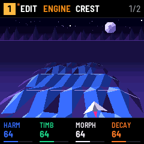

| Page | K1 | K2 | K3 | K4 |
| --- | --- | --- | --- | --- |
| ENGINE | HARM, 0–127 | TIMB, 0–127 | MORPH, 0–127 | DECAY, 0–127 |
| SOUND | MODEL, by name, by family | TUNE, −24 to +24 semitones | GLIDE, 0–127 | POLY, 1–4 voices |

- **HARM, TIMB, MORPH** do something different on each model: each family's page says what (Models, below).
- Where HARM picks one of a few choices (a preset on HEX A–C, a chord on CHORALE, ENSEMBLE and ARCADE, a word bank on
  ORATOR past its blend of synths, from 43), each detent moves to the next choice and the footer shows its name; so
  does TIMB on ARCADE (its arpeggio).
- **DECAY** sets how long a note rings after its gate closes. HEX A–C, WIRE, CHLADNI and the drums make their own
  envelope: they have no DECAY (K4 is blank), and their MORPH sets how long they ring.
- **TUNE** transposes the track. **GLIDE** slides from one note to the next; 0 is off.
- **POLY** is how many notes the track plays at once. The keys get POLY notes of their own beside the pattern's, so
  a note you hold keeps sounding while the pattern plays (on a kit, a pad still cuts its sound's last hit). The four
  tracks share six voices; when they are all busy, a new note takes a released note first, whatever its track, then
  its own track's oldest (on a kit, another drum's), and only then another track's held note: a kit's hits spare the
  chords. A voice taken from another track fades out over 1.5 ms first, so the new note starts up to 7 ms late.

The model's name shows in the header of ENGINE and SOUND, and under MODEL in SOUND's footer.

### Models

The models are Plaits' 24 synthesis models under QUARTZ's own names, sorted by family: PRESET goes through them in
the order of the table. Each family has its own scene. At their default settings, the models and the kit's three
drums play at about the same loudness: QUARTZ evens out Plaits' own levels, which differ by up to 20 dB.

Each family has a page of its own: what each model sounds like, what HARM, TIMB and MORPH do at their ends, where to
start and a few recipes.

| Family | Models | Sound |
| --- | --- | --- |
| [Analog](synth-analog.html) | CREST, SWEEP, KINK, PRISM | Classic waves, a resonant filter, phase distortion, a folded triangle |
| [FM](synth-fm.html) | MOON, HEX A, HEX B, HEX C | Two-operator FM; six-operator FM with 96 presets |
| [Tables](synth-tables.html) | PIPE, BOWL | Wavetables and a wave terrain |
| [Spectral](synth-spectral.html) | FACETS, POLLEN | Harmonics added up; formants |
| [Chords](synth-chords.html) | CHORALE, ENSEMBLE, ARCADE | Four-note chords, a string machine, chip arpeggios |
| [Voice](synth-voice.html) | ORATOR | Vowels and words |
| [Noise](synth-noise.html) | CROWD, STATIC, GLITTER | A swarm of saws, filtered noise, dust |
| [Physical](synth-physical.html) | WIRE, CHLADNI | A plucked string, a struck body |
| [Drums](synth-drums.html) | BASS DRUM, SNARE, HI-HAT, KIT | Analog drums, and the kit of 16 pads |

On the drums, HEX A–C, WIRE and CHLADNI, the model makes its own envelope: ENV's ADSR then shapes only the filter.

**Inspired by** [Plaits](https://pichenettes.github.io/mutable-instruments-documentation/modules/plaits/manual/)
by Mutable Instruments (Emilie Gillet), with the eight models of its
[firmware 1.2](https://pichenettes.github.io/mutable-instruments-documentation/modules/plaits/firmware/) (SWEEP, KINK,
HEX A–C, BOWL, ENSEMBLE and ARCADE). QUARTZ runs
Plaits' own code. It adds to it what a module gets from its patch: notes and velocity from the keys and the
sequencer, up to four voices per track, GLIDE, an ADSR, a filter, an LFO, an arpeggiator and effects. CHLADNI's name
and scene come from [Chladni figures](https://en.wikipedia.org/wiki/Ernst_Chladni#Chladni_figures) (Ernst Chladni,
1787): the patterns sand draws on a vibrating plate.

### KIT

KIT turns the track into 16 drum pads on the white keys, each one of the three drums with its own tuning and
settings. Its pages, its pads and CHAR are on the [Drums](synth-drums.html#kit) page.

---

## 7. Shaping

Each voice goes through Plaits' low-pass gate, which follows the envelope, then a filter. The track then goes through
its insert effect, its level and its pan, and sends to the shared delay and reverb. Everything on these pages is per
track. The scenes show the model's name and draw what the knobs set.

### ENV

| Page | K1 | K2 | K3 | K4 |
| --- | --- | --- | --- | --- |
| ADSR | ATTACK | DECAY | SUSTAIN | RELEASE |
| FILTER | TYPE: LP, HP, BP | CUTOFF | RES | ENV AMT, −64 to +63 |

- ATTACK, DECAY and RELEASE go from 1 ms to 10 s. SUSTAIN is the level held while the note is on.
- The ADSR sets the voice's level, scaled by the velocity. On the models with their own envelope (HEX A–C, WIRE,
  CHLADNI, the drums and the KIT), it only moves the filter.
- CUTOFF goes from 20 Hz to 20 kHz; 127 on LP lets everything through. RES goes up to the edge of self-oscillation.
- ENV AMT is how far the ADSR moves the cutoff, up to eight octaves either way. An accented step moves it 1.5 times as
  far ([step functions](sequencer.html#step-functions)).
- ENV DEST: on the FILTER page, PRESET sends the envelope elsewhere than the cutoff: CUTOFF, PITCH (up to two octaves
  either way, for a pitched kick or a pluck that falls into tune), HARM, TIMB or MORPH (the whole knob's travel, for a
  sound whose timbre opens and closes with each note). The scene says `ENV → PITCH`, and ENV AMT's gauge shows how far
  and which way. A new project's is CUTOFF.
- The scene draws the filter's response over the frequencies, 20 Hz on the left to 20 kHz on the right: the cutoff's
  pillar, the resonance's peak with its crystal, and in orange wire the response the envelope takes it to (with ENV
  DEST on CUTOFF). A note sweeps the curve, in pink.

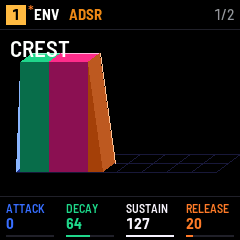

### LFO

| Page | K1 | K2 | K3 | K4 |
| --- | --- | --- | --- | --- |
| LFO | SHAPE: SIN, TRI, SAW, SQR, S&H | RATE | DEPTH, −64 to +63 | DEST |
| LFO 2 | SHAPE | RATE | DEPTH, 0 in a new project: off | DEST, PITCH in a new project |

- RATE first offers 12 speeds in time with the tempo (8 BAR, 4 BAR, 2 BAR, 1 BAR, 1/2, 1/4, 1/4T, 1/8, 1/8T, 1/16,
  1/16T, 1/32), then free speeds from 0.05 Hz to 30 Hz.
- DEST: HARM, TIMB, MORPH, PITCH (±12 semitones), CUTOFF (±5 octaves), RES, LEVEL, PAN or INSERT. The LFO adds to the
  value set on the page, or to its p-lock.
- PAN and INSERT move the whole track, not each note: PAN sweeps it left and right around MIX's PAN (an auto-pan),
  INSERT turns the insert's first knob around its setting (a phaser's or a comb's sweep, a moving wavefold). At DEPTH
  63 they cover the knob's whole travel. While a note sounds, its step's LFO p-locks apply (a step can send the LFO to PAN on its own);
  TRIG follows that note. With none, the track's settings, and TRIG waits at the wave's start.
- PRESET switches FREE and TRIG, shown in the header. FREE runs on its own, and a synced rate starts with the bar at
  PLAY. TRIG starts the shape again on each note.
- S&H takes a new random value each cycle.
- The LFO's jumps (SAW's return, SQR's edges, S&H's steps) glide over about 2 ms, so they do not click.
- LFO 2 is a second LFO, the same in every way, with its own FREE or TRIG (PRESET on its page). On two destinations it
  moves two things at once; on the same one, the two add up: a slow sweep with a fast wobble on top, for example.

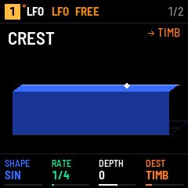

### ARP

| Page | K1 | K2 | K3 | K4 |
| --- | --- | --- | --- | --- |
| ARP | MODE: OFF, UP, DOWN, UP-DN, RAND, ORDER | OCT, 1–4 | DIV, 1/32 to 1/1 | GATE, 5–100 % |

- The arpeggiator plays the notes held, from the keys or from the steps: a chord on a step is arpeggiated for as long
  as the step lasts. A single note is repeated, over OCT octaves.
- UP-DN does not repeat the top and bottom notes. ORDER follows the order the notes came in.
- It runs at its own DIV, in time with the tempo but without swing. GATE is how long each note lasts.
- **Latch**: hold ARP and press keys. Their notes stay in the arpeggio after you let go, until you press a key without
  ARP.
- A KIT track ignores the arpeggiator.

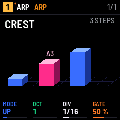

### FX

| Page | K1 | K2 | K3 | K4 |
| --- | --- | --- | --- | --- |
| MIX | DELAY send | REVERB send | PAN, −64 to +63 | LEVEL |
| INSERT | depends on the type | depends on the type | depends on the type | MIX |

On INSERT, PRESET picks the insert's type, shown as the page's name. K4 MIX blends it with the dry sound: 0 is dry
only, 127 is the effect only. The three other knobs keep their values when you change the type.

WAVEFOLD starts almost clean at FOLD 0 and folds more as you turn it; its level follows the dry sound's, so folding
changes the tone, not the volume. BIAS makes the folds uneven.

FILTER is a second, resonant filter after the voices, for the whole track: MODE blends low-pass into band-pass into
high-pass, and a soft clip keeps a high RES ringing without bursting. With an LFO on INSERT (DEST), FREQ sweeps.
TAPE plays the track through a worn tape: WOW bends the pitch slowly (0.6 Hz), FLUTTER quickly (9 Hz), DRIVE saturates
and darkens it.

| Type | K1 | K2 | K3 |
| --- | --- | --- | --- |
| INSERT OFF | — | — | — |
| OVERDRIVE | DRIVE | TONE | — |
| WAVEFOLD | FOLD | BIAS | TONE |
| BITCRUSH | BITS, 16 to 2 | RATE, 44.1 kHz to 500 Hz | — |
| CHORUS | RATE, 0.05 to 5 Hz | DEPTH | — |
| PHASER | RATE, 0.05 to 5 Hz | DEPTH | FEEDBK |
| RING MOD | FREQ, 20 Hz to 5 kHz | — | — |
| COMB | NOTE, F1 and up | FEEDBK | DAMP |
| FILTER | FREQ, 20 Hz to 18 kHz | RES | MODE: LP, then BP, then HP |
| TAPE | WOW | FLUTTER | DRIVE |

The delay and the reverb are shared by the four tracks; DELAY and REVERB set how much of the track goes to each.
They are set on GLO's FX page (section 10): the delay is a ping-pong in time with the tempo, the reverb is Clouds'.

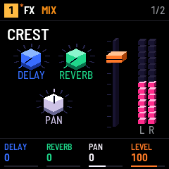

### Punch-ins

Hold FX and press white keys: each one is an effect on the whole mix, for as long as you hold its key. Several can
be held together. Its name shows in the header; let go of FX and they all stop.

| Key | Punch-in | What it does |
| --- | --- | --- |
| 1–4 | LOOP 1/8, LOOP 1/12, LOOP 1/16, LOOP 1/32 | Repeats the last slice of that length, started on the beat grid. |
| 5 | TAPE STOP | Slows down to a stop over a beat, pitch falling, then silence. |
| 6 | LOW-PASS | A low-pass at 400 Hz. |
| 7 | HIGH-PASS | A high-pass at 1.5 kHz. |
| 8 | SWEEP | A resonant low-pass sweeping down and up once a bar. |
| 9 | BITCRUSH | 6 bits. |
| 10 | DOWNSAMPLE | 4 kHz. |
| 11 | GATE 1/16 | Cuts every other sixteenth. |
| 12 | AUTO-PAN | Left to right and back once a beat. |
| 13 | DELAY THROW | Sends the whole mix into the delay; the echoes go on after you let go. |
| 14 | FREEZE | Holds the reverb's tail; it fades when you let go. |
| 15 | STUTTER | Repeats faster each beat: 1/8, 1/16, 1/32, then 1/64. |
| 16 | STUT GATE | Repeats 1/64 slices, each cut in half. |

While recording LIVE on a STEP pattern, the punch-ins you hold are written on the steps they cross ([LIVE](sequencer.html#live)), and
play back with the pattern.

Black key 1, with FX held, is FILL: while you hold it, the steps whose COND is FILL play and those with !FILL don't, on
every track ([COND](sequencer.html#step-functions)). Let go of the key or of FX and the pattern plays as written again.
FILL is not recorded.

Black key 2, with FX held, LATCHes the punch-ins you hold, and those you press after it while FX stays held: they stay
on after you let go of their keys and of FX, so that both hands are free (`LATCHED`). Tap FX to let them go (`LATCH OFF`). TAPE STOP, DELAY THROW and FREEZE are never
latched: they would leave the mix silent or drowned. While recording LIVE, the latched ones are written on every step
crossed.

**Inspired by** the [OP-Z's punch-in effects](https://teenage.engineering/guides/op-z/punch-in-effects): a held key
for a momentary effect on the mix, recorded with the pattern. QUARTZ's are its own set of sixteen. The reverb is
[Clouds'](https://pichenettes.github.io/mutable-instruments-documentation/modules/clouds/manual/) by Mutable
Instruments.

---

## 8. Sequencer

Press SEQ. A STEP pattern is the one you write yourself, step by step; the STEPS page shows its current 16 steps as
blocks on a 4 x 4 plateau, each with its note on top and as high as its velocity. LEN, DIV, PATH and SOURCE are its
knobs.

Without REC, the keys play the track. Short presses on REC make them write:

| Where | Short presses on REC |
| --- | --- |
| SEQ, a STEP pattern | off, GRID, NOTES, off |
| Other domains | off, NOTES (LIVE while playing), off |

The [Sequencer](sequencer.html) page has it all: the paths, the grid, a held step and its functions, p-locks, several
steps at once, NOTES, LIVE, REC held, random draws and recipes.

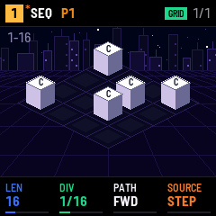

---

## 9. Sources

Each pattern has a source: where its notes come from. SOURCE is always K4 of SEQ's first page, so you change it with
the same knob whatever the source. A pattern keeps its steps and the settings of every source, so you can go back.
A scene can switch a track from one source to another, since each pattern has its own.

Each source has a page of its own: what each knob does at its ends, its scene, PRESET, what it does on a kit and a
few recipes.

| Source | In a word |
| --- | --- |
| [STEP](sequencer.html) | The step sequencer. |
| [ATLAS](source-atlas.html) | A map of drum rhythms. |
| [FLEET](source-fleet.html) | Random rhythms and melodies, which can loop. |
| [COLONY](source-colony.html) | The Game of Life, read as notes. |
| [LOOM](source-loom.html) | Five loops of different lengths: trigger, note, octave, length, velocity. |
| [CADENCE](source-cadence.html) | A chord progression. |
| [LATTICE](source-lattice.html) | A walk from chord to chord on the Tonnetz. |
| [MOONS](source-moons.html) | Moons on orbits, each playing as it passes. |
| [IMPROV](source-improv.html) | An improviser that learns a phrase from you. |
| [CIPHER](source-cipher.html) | Bytebeat: a formula of time per step decides the rhythm, the accent and the note. |

What the generative sources (all but STEP) share:

- They play at the pattern's DIV, with the project's swing. Their notes go through the arpeggiator, the mutes and
  the scenes like a STEP pattern's.
- A loop is 16 steps (ATLAS, FLEET and CIPHER their LEN): a pattern change waits for its end, and a song entry counts it.
- SEQ held and black key 5 twice PRINTs the next loop into STEP steps ([Patterns](#patterns)).
- Without REC, the keys play the track. REC writes nothing in them, except LOOM, CADENCE and LATTICE, which have a
  GRID of their own, and IMPROV, which listens.
- PRESET always does something useful for the source: each source's page says what.
- On a synth track, setting SOURCE to CADENCE, LATTICE, MOONS or IMPROV raises POLY to 3 if it is lower, so their
  chords sound.
- COLONY, LOOM, CADENCE, LATTICE, MOONS and CIPHER count in degrees of GLO's scale, up from their NOTE brought into the
  scale. FLEET has its own allowed notes; ATLAS plays a fixed NOTE; IMPROV plays the notes it learnt.

### STEP

The pattern you write yourself: see the [Sequencer](sequencer.html) page. PRESET picks the pattern; on a held step, it sets the step's function.

---

## 10. Global

Press GLO for the project's settings, shared by the four tracks.

| Page | K1 | K2 | K3 | K4 |
| --- | --- | --- | --- | --- |
| TEMPO | TEMPO, 40–240 BPM | SWING, 50–75 % | COMP, 0–127 | DUCK, 0–127 |
| SCALE | TONIC, C to B | MODE | QUANT: OFF, 50 %, 100 % | CLICK: OFF, METRO, COUNT, BOTH |
| KEYS | IN SCALE: OFF, ALL | — | — | — |
| FX | DLY TIME, 1/32 to 1/1 | DLY FB | REV SIZE | REV TONE |
| CPU | — | — | — | — |

- **TAP TEMPO**: hold GLO and tap black key 1 on the beat, from any page. From the second tap, TEMPO follows the
  mean gap of your last four taps, in whole BPM, 40–240; the header shows `TAP` and the tempo. A pause over 2 s
  starts the count again. While playing, only the speed changes: the patterns go on from the step they are at.
- **Transpose**: hold GLO and press another key: the steps of every synth track play transposed, so that the tonic
  sounds as that key's note (`TRANSPOSE +4`). The tonic's key puts them back. With KEYS at ALL, the white keys are
  degrees of the scale (white key 1 the tonic, as when playing; OCT moves an octave of the scale), and the notes stay
  in the scale (on FLEET, in its allowed notes); with KEYS OFF, the keys are semitones from the tonic nearest the middle of the keyboard. Only the
  sequencer is transposed, not the keys you play nor the KIT tracks; it lasts until changed, and is not saved.
- **SWING** delays every other step; 50 % is straight.
- **COMP** compresses the whole mix; 0 is off. A limiter always protects the output.
- **DUCK** lowers the synth tracks and the effects on each bass drum pad of a KIT track, up to −24 dB, like a
  sidechain; 0 is off.
- **TONIC** and **MODE** make the project's scale. The generative sources count their degrees in it, FLEET starts
  from it, and KEYS plays it. MODE: CHROM, MAJOR, MINOR, DORIAN, PHRYG, LYDIAN, MIXO, LOCRIAN, HARM MIN, PENTA,
  MIN PENTA.
- **QUANT** pulls the notes recorded in LIVE onto the steps: OFF keeps your timing, 100 % puts them on the step.
- **CLICK**: METRO plays a click while recording LIVE, COUNT a bar of count-in before LIVE, BOTH both.
- **KEYS**: OFF, the keys are a chromatic keyboard. ALL: on every synth track, the white keys play the scale up from
  the tonic (on FLEET tracks, their allowed notes) and the black keys are silent. A kit keeps its pads: on a KIT
  track, the page numbers the white keys 1–16 and crosses out the black ones. The keys you hold light up pink.
- **FX**: the shared ping-pong delay, its time in steps of the tempo and its feedback; the reverb's size and its
  tone (how much of the highs it keeps).
- **CPU** shows each core's load, LOST BLOCKS (audio blocks the FM-1 could not compute in time: you hear them as
  clicks), the voices in use, the effects' share and the screen's frame rate.

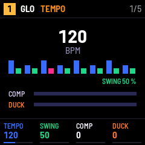

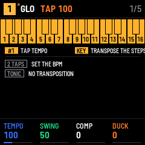

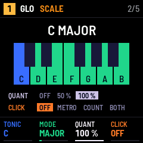

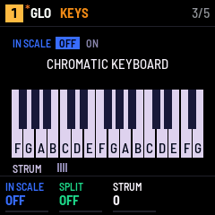

---

## 11. Saving

QUARTZ keeps four projects, each with its four tracks, their patterns and sounds, the scenes, the song and the global
settings. One is in memory at a time: the one you play and edit.

- Press SAVE while stopped to write it to the FM-1, in its own place. At power-on, the FM-1 loads the project saved
  last.
- To load another, hold SAVE and press black key 2, 3, 4 or 5 for project 1, 2, 3 or 4: the header says `AGAIN: LOAD`,
  or `UNSAVED: LOAD?` when the project in memory changed since its last SAVE; press it again within three seconds. The header then says `PROJECT 2`, for example, and SAVE writes project 2. Loading
  stops playing, and what you changed since the last SAVE is lost; loading the same project goes back to its last SAVE.
  A project never saved is a new one. SAVE's map marks the project loaded, `(NOW)`.
- What you copied (SEQ held, black keys 1 and 3) stays when you load another project: copy a pattern or a sound in one,
  paste it in the other.
- The `*` beside the track's number in the header says the project changed since its last SAVE.
- While playing, SAVE shows `SAVE AT STOP`: writing to the flash would stall the sound, so the save is made when you
  stop (PLAY, or a project loaded or started meanwhile). It cannot be called off; the `*` goes once it is done.
- Nothing is saved on its own (but by a backup, below): turning the FM-1 off loses what changed since the last SAVE.
- A new project (SAVE held, black key 1 twice) replaces the one in memory; the saved one stays until the next SAVE,
  which writes the new project in its place.

To keep the projects on a computer, use the site's backup page in Chrome or Edge, with the FM-1 connected by USB, or
fm1-base's `python3 tools/fm1_backup.py`. The emulator saves and loads the same files, so a project started in the
browser goes on the FM-1, and back. A backup holds the four projects.

- Taken while stopped, a backup first saves what changed, as SAVE does, and holds it. Taken while playing, it holds the
  project as last saved.
- A restore replaces the four projects, after the FM-1 asks `RESTORE FROM USB?` (SEL yes, HOME no). Stop playing first: a
  restore is refused while playing. Then the FM-1 loads the project saved last in the backup.
- A backup restores only on a version that saves projects the same way: one taken before an update that starts a new
  project is refused, and nothing changes.

---

## 12. Credits and inspirations

QUARTZ is made by f0nski. It stands on the work of others: code it runs, and ideas it borrows.

| QUARTZ | Origin | By | Licence | Link |
| --- | --- | --- | --- | --- |
| The 24 models | Plaits, with firmware 1.2's models | Mutable Instruments (Emilie Gillet) | MIT | [manual](https://pichenettes.github.io/mutable-instruments-documentation/modules/plaits/manual/) |
| ATLAS | Grids' drum map and pattern generator | Mutable Instruments (Emilie Gillet) | GPL-3.0 | [manual](https://pichenettes.github.io/mutable-instruments-documentation/modules/grids/manual/) |
| FLEET | Marbles' t models, X draws and DEJA VU | Mutable Instruments (Emilie Gillet) | MIT | [manual](https://pichenettes.github.io/mutable-instruments-documentation/modules/marbles/manual/) |
| The reverb | Clouds' reverb | Mutable Instruments (Emilie Gillet) | MIT | [manual](https://pichenettes.github.io/mutable-instruments-documentation/modules/clouds/manual/) |
| COLONY | The Game of Life (idea) | John Horton Conway, 1970 | — | [Wikipedia](https://en.wikipedia.org/wiki/Conway%27s_Game_of_Life) |
| LOOM | Kria (idea) | monome | — | [docs](https://monome.org/docs/ansible/kria/) |
| LATTICE | The Tonnetz and neo-Riemannian theory (idea) | Leonhard Euler; David Lewin, Richard Cohn | — | [Wikipedia](https://en.wikipedia.org/wiki/Neo-Riemannian_theory) |
| IMPROV | The Continuator (idea) | François Pachet, Sony CSL, 2003 | — | [paper](https://www.francoispachet.fr/?p=4360) |
| PATH XY | René's X and Y clocks (idea) | Make Noise | — | [René](https://www.makenoisemusic.com/modules/rene) |
| Step functions | Parameter locks, trig conditions, micro timing (idea) | Elektron | — | [Digitakt](https://www.elektron.se/support-downloads/digitakt) |
| Domains, held-button maps, punch-ins, this guide's shape | The OP-Z (idea) | teenage engineering | — | [guide](https://teenage.engineering/guides/op-z) |
| The scenes' look | Rez (idea) | United Game Artists (Tetsuya Mizuguchi), 2001 | — | [Wikipedia](https://en.wikipedia.org/wiki/Rez_%28video_game%29) |
| CHLADNI's name and scene | Chladni figures (idea) | Ernst Chladni, 1787 | — | [Wikipedia](https://en.wikipedia.org/wiki/Ernst_Chladni#Chladni_figures) |
| CIPHER | Bytebeat (idea) | viznut, 2011 | — | [post](http://countercomplex.blogspot.com/2011/10/algorithmic-symphonies-from-one-line-of.html) |
| CADENCE, MOONS, the scenes | QUARTZ's own | f0nski | GPL-3.0 | — |
| The platform | fm1-base, on felucca-bsp | Charles Vestal; Leo Kuroshita (Hügelton Instruments) | MPL-2.0 | [fm1-base](https://github.com/charlesvestal/fm1-base) |

QUARTZ itself is free software under the GPL-3.0-or-later; its [source](https://github.com/F0nski/quartz) holds the
licences of each part. M-VAVE and FM-1 are trademarks of their owners; QUARTZ is not affiliated with M-VAVE, Mutable
Instruments, monome, Make Noise, Elektron or teenage engineering.

---

## 13. Troubleshooting

| Problem | What to check |
| --- | --- |
| No sound | MASTER; HOME, the track's mute (HOME held, keys 1–4) and its LVL; FX's MIX LEVEL; ENV's CUTOFF on LP. |
| A key does nothing | A button may still be held (its map is on the screen). With KEYS at ALL, the black keys are silent. |
| REC does nothing | The pattern is generative: only LOOM, CADENCE and LATTICE have a GRID, and IMPROV listens. To record notes, set SOURCE to STEP. |
| The pattern doesn't change | While playing, it waits for the end of the loop (`P1 > P2` in the header); hold SEL too for at once. |
| `SAVE AT STOP` | The save is made when you stop. |
| `LOCKS FULL` | The pattern holds 128 p-locks: clear some (REC held, black key 2 clears them all). |
| Clicks in the sound | GLO's CPU page: LOST BLOCKS counts them. Lower POLY, use lighter models than CHLADNI or FACETS on several tracks, or fewer inserts. |
| The project is gone after an update | The new version saves projects differently and starts from a new one (section 2). |
| Back to the stock firmware | The installer's last section writes M-VAVE's firmware back. |
