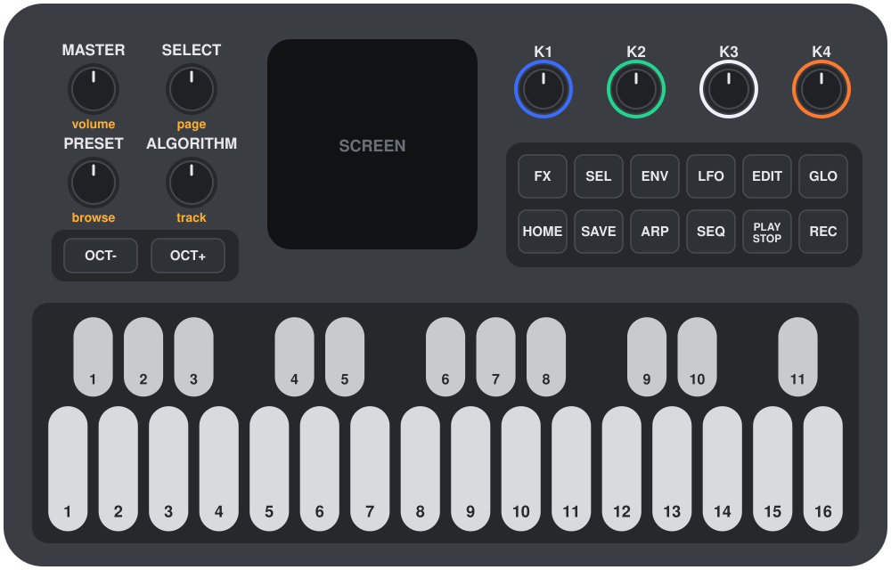
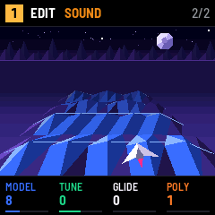
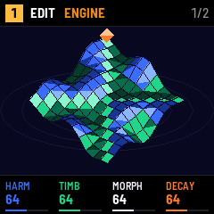
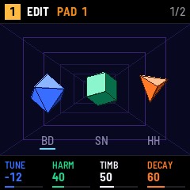

# QUARTZ

QUARTZ is a four-track groovebox for the M-VAVE FM-1. This manual starts with the controls and a first beat, then
goes through each page: the sounds, how to shape them, the sequencer, the pattern sources and the global settings.

---

## Contents

1. Overview
2. Install
3. The FM-1 at a glance
4. Quick start
5. Tracks, patterns and song
6. Sound
7. Shaping
8. Sequencer
9. Sources
10. Global
11. Saving
12. Credits and inspirations
13. Troubleshooting

---

## 1. Overview

QUARTZ has four tracks. Each track has a sound, which is one of 24 models (21 synths and 3 drums) or a kit of 16
drum pads, and eight patterns. A pattern takes its notes from a source: STEP is a step sequencer you write yourself, and the eight
others generate notes as they play (section 9). You can always play the current track on the keys, whatever its
source.

Everything is reached with one button and a few pages, with no menus. A button opens a *domain* (EDIT, SEQ, GLO,
HOME, ENV, LFO, ARP, FX), SELECT turns its pages, and the four knobs K1–K4 set what the page shows. Most pages show
an animated *scene* that moves with the sound and with every knob.

| Word | Meaning |
| --- | --- |
| Track | One of the four parts, 1–4. ALGORITHM picks the current one. |
| Sound | What a track sounds like: a model (EDIT) shaped by ENV, LFO, ARP and FX. |
| Pattern | P1–P8, eight per track. A track plays one pattern at a time. |
| Source | Where a pattern's notes come from: STEP, ATLAS, FLEET, COLONY, LOOM, CADENCE, LATTICE, MOONS or MIMIC. |
| Step | One of a STEP pattern's 64 places, 16 per page of the grid. |
| P-lock | A knob's value stored on a single step. |
| Scene | The four patterns playing and the mutes, kept together. Eight per project. |
| Song | A list of scenes, each played a number of times. |
| Project | Everything above, the tempo, the scale and the effects. QUARTZ keeps one project. |

**Inspired by** the [OP-Z](https://teenage.engineering/guides/op-z) by teenage engineering: one button per domain,
held buttons that turn the keys into shortcuts, punch-in effects, and the shape of this guide.

---

## 2. Install

To try QUARTZ first, open the emulator. It runs the same code in your browser, with sound, and you can play it with a
mouse, a touch screen or your computer keyboard.

To install it from the browser, use Chrome or Edge. Connect the FM-1 by USB, open the installer and press Install.
The browser asks once to allow MIDI, so allow it. Don't unplug the cable while it writes.

To install it from a terminal, use fm1-base's installer: `python3 tools/fm1_install.py quartz-VERSION.fwsc`. If the
install stops early, add `--classic` and run it again: it resumes where it stopped.

To go back to the stock firmware, use the installer's last section, which writes M-VAVE's own firmware back.

> An update can change how projects are saved. While QUARTZ is still young, the project saved by an older version
> is then not loaded, and you start from a new project. Note down anything you want to keep.

---

## 3. The FM-1 at a glance

### Knobs

| Knob | What it does |
| --- | --- |
| MASTER | The volume. |
| SELECT | Turns the pages of the domain shown. On a held step, it turns the step's p-lock pages. |
| ALGORITHM | Picks the track, 1–4. |
| PRESET | Browses what the page is about: the model on EDIT, the pattern on SEQ (or what the source uses it for, section 9), the insert's type on INSERT, FREE or TRIG on LFO, the entry on SONG. |
| K1–K4 | Set the four values at the bottom of the screen, in their colours: blue, green, white, orange. |

### Buttons

| Button | Short press | Held |
| --- | --- | --- |
| EDIT | The sound: ENGINE, SOUND (a kit: PAD, KIT). | — |
| ENV | The envelope and the filter: ADSR, FILTER. | — |
| LFO | The LFO. | — |
| ARP | The arpeggiator. | The notes you press stay in the arpeggio after you let go (latch). |
| FX | The track's effects: MIX, INSERT. | The white keys are the 16 punch-ins. |
| SEQ | The pattern: STEPS, then its source's pages. | White keys 1–8 pick the track's pattern. |
| GLO | The project: TEMPO, SCALE, KEYS, FX, CPU. | — |
| HOME | The four tracks and the song: TRACKS, SONG. | White keys 1–4 mute the tracks, 9–16 are the scenes. |
| SAVE | Saves the project (stopped only). | White keys 1–8 add a scene to the song; black key 1 twice starts a new project. |
| SEL | On SONG, removes the entry shown. | Selects steps on the grid (section 8). |
| PLAY | Starts or stops every track. | — |
| REC | Arms the recording (section 8). | Black key 1 clears the pattern, black key 2 its p-locks. With PLAY: records live. |
| OCT- / OCT+ | The keyboard's octave, −2 to +2. On the grid: the page of steps. | — |

A short press is a press released before 0.4 s with nothing else pressed meanwhile. A button held longer does not do
its own action when you let it go.

### Keys

The 27 keys start on F. Unless a page gives them another role, they play the current track: the notes of a synth
model, or the 16 pads of a kit on the white keys. The black keys are numbered 1–11 and the white keys 1–16 from the
left, as the screen numbers them.

### The screen

- **Header**: the track in a box, the domain and the page (on SEQ, the pattern: `P1 > P2` while the next one waits
  for the end of the loop), the page's number, and REC's state when it is armed (GRID, NOTES, LIVE, ARM, LISTEN).
- **Scene**: what the page sets, animated. It reacts to every knob of the page and to each note played, in pink.
- **Footer**: K1–K4, their names and values in their colours. A grey one is not in use on this page.

Messages show in the header for a moment: `STOP TO SAVE` (SAVE while playing), `LOCKS FULL` (no room for another
p-lock in the pattern), `AGAIN: ERASE` (press again to start a new project), or the name of a punch-in.

### Held buttons show their map

Hold HOME, FX, SAVE, SEQ, ARP, SEL or REC for more than 0.4 s: the scene makes room for a map of the keys. The keys
that have a role are lit and named, and the combinations with other buttons are listed under them. The map follows
your presses, so you can look up a shortcut and use it in the same gesture.

---

## 4. Quick start

A kick on track 1 and a melody on track 2, from a new project.

1. Press EDIT, then turn PRESET until the footer shows the kit: the header says `PAD 1` and the scene shows the kit's
   three drums.
2. Press SEQ, then REC once. The header shows `GRID`: the white keys are now the 16 steps.
3. Press white keys 1, 5, 9 and 13. Each one becomes a step with the bass drum (pad 1).
4. Press PLAY. The kick plays four on the floor; the white keys light as the steps pass.
5. Turn ALGORITHM one notch to track 2, then press REC once more. The header shows `NOTES 1`: whatever you play is
   written at the cursor, which then moves on.
6. Play four notes. They fill steps 1 to 4, and you hear them as the loop comes round.
7. Press REC to disarm. Now try the knobs on EDIT, ENV and FX, or turn SEQ's SOURCE to another source.

---

## 5. Tracks, patterns and song

### Tracks

ALGORITHM picks the current track: the keys play it and the pages set it. HOME's TRACKS page shows the four tracks
on their pedestals, with the pattern each plays and its model, and its knobs are a mixer.

| Page | K1 | K2 | K3 | K4 |
| --- | --- | --- | --- | --- |
| TRACKS | LVL 1: track 1's level, 0–127 | LVL 2 | LVL 3 | LVL 4 |

To mute a track, hold HOME and press white key 1–4. A muted track's pedestal goes dark and its key goes out.

### Patterns

Each track has eight patterns, P1–P8. To pick one, hold SEQ and press white key 1–8, or turn PRESET on a STEP
pattern's pages. While playing, the new pattern starts when the one playing reaches the end of its loop; the header
shows `P1 > P2` meanwhile.

To clear the pattern shown, hold REC and press black key 1. To remove only its p-locks, hold REC and press black key 2.
Neither can be undone.

### Scenes

A scene keeps the pattern of each track and the mutes. Hold HOME and press white key 9–16 for scene 1–8:

- an empty scene stores what plays now;
- a stored scene comes back at once when stopped, and at the next bar while playing (the header shows `SCENE n`
  until then);
- with SEL held too, the scene is stored again over the old one.

The keys 9–16 are lit on HOME for the scenes in use.

### Song

The song is a list of up to 32 entries, each a scene played a number of times. Hold SAVE and press white key 1–8 to
add that scene at the end of the song. Then set it on HOME's SONG page:

| Knob | What it does | Range |
| --- | --- | --- |
| PRESET or K1 ENTRY | The entry shown. | 1 – the number of entries |
| K2 SCENE | The scene the entry plays. | 1–8 |
| K3 REPEAT | How many times it plays. | 1–16 |
| K4 MODE | PATTERN: PLAY starts the patterns as they are. SONG: PLAY starts at the first entry and goes through the list, then loops. | PATTERN, SONG |

An entry lasts its REPEAT times the length of its longest pattern, rounded up to whole bars. Press SEL on the SONG page
to remove the entry shown.

### New project

Hold SAVE and press black key 1: the header says `AGAIN: ERASE`. Press black key 1 again within three seconds to
replace the project with a new one. The old one is still in the FM-1 until you press SAVE.

---

## 6. Sound

Press EDIT. The ENGINE page sets the model's own four controls, SOUND picks the model and how it is played. PRESET
browses the models from any EDIT page.

| Page | K1 | K2 | K3 | K4 |
| --- | --- | --- | --- | --- |
| ENGINE | HARM, 0–127 | TIMB, 0–127 | MORPH, 0–127 | DECAY, 0–127 |
| SOUND | MODEL, 0–24 | TUNE, −24 to +24 semitones | GLIDE, 0–127 | POLY, 1–4 voices |

- **HARM, TIMB, MORPH** do something different on each model: the table below says what.
- **DECAY** sets how long a note rings after its gate closes, and the length of the model's own envelope on the models
  that have one (HEX A–C, WIRE, CHLADNI and the drums).
- **TUNE** transposes the track. **GLIDE** slides from one note to the next; 0 is off.
- **POLY** is how many notes the track plays at once. The four tracks share six voices; when they are all busy, a
  new note takes the oldest one.

The footer shows the model's number. Its name shows on HOME's TRACKS page and on the ENV, LFO, ARP and FX pages.

### Models

The models are Plaits' 24 synthesis models, in Plaits' order, under QUARTZ's own names. Each family has its own
scene.

| # | Name | Sound | HARM | TIMB | MORPH | Plaits model |
| --- | --- | --- | --- | --- | --- | --- |
| 0 | SWEEP | Classic waves through a resonant filter | Resonance and filter slope | Cutoff | Waveform and sub | Virtual analog with VCF (1.2) |
| 1 | KINK | Phase distortion | Distortion frequency | Amount | Asymmetry | Phase distortion (1.2) |
| 2 | HEX A | 6-operator FM, basses and synths | Preset, 1 of 32 | Modulator levels | Envelope stretch | 6-op FM, bank 1 (1.2) |
| 3 | HEX B | 6-operator FM, keys, plucks, percussion | Preset | Modulator levels | Envelope stretch | 6-op FM, bank 2 (1.2) |
| 4 | HEX C | 6-operator FM, organs, pads, strings, brass | Preset | Modulator levels | Envelope stretch | 6-op FM, bank 3 (1.2) |
| 5 | BOWL | A path read on a 2D terrain | Terrain | Path radius | Path offset | Wave terrain (1.2) |
| 6 | ENSEMBLE | String machine with filter and chorus | Chord | Chorus and filter | Waveform | String machine (1.2) |
| 7 | ARCADE | Square-wave chords and arpeggios | Chord | Arpeggio or inversion | Pulse width, sync | Chiptune (1.2) |
| 8 | CREST | Two classic analog waveforms | Detune | Pulse to sync | Triangle to saw | Virtual analog |
| 9 | PRISM | A triangle shaped and folded | Waveshape | Fold | Asymmetry | Waveshaper |
| 10 | MOON | Two sine operators | Ratio | Modulation index | Feedback | 2-operator FM |
| 11 | POLLEN | Formants from sine segments | Formant ratio | Formant frequency | Width and shape | Granular formant |
| 12 | FACETS | Harmonics added up | Spectral bumps | Main harmonic | Bump shape | Additive |
| 13 | PIPE | Wavetables, 4 banks of 8 x 8 | Bank | Row | Column | Wavetable |
| 14 | CHORALE | Four-note chords | Chord | Inversion | Waveform | Chords |
| 15 | ORATOR | Vowels and words | Vowels, then word banks | Voice size | Phoneme or word | Speech |
| 16 | CROWD | Eight sawtooths in a swarm | Pitch spread | Density | Grain duration | Swarm |
| 17 | STATIC | Clocked noise through a filter | Low-pass to high-pass | Clock | Resonance | Filtered noise |
| 18 | GLITTER | Dust through resonators | Frequency spread | Density | Filter type | Particle noise |
| 19 | WIRE | A plucked string | Inharmonicity | Brightness | Decay | Inharmonic string |
| 20 | CHLADNI | A struck resonant body | Material | Brightness | Decay | Modal resonator |
| 21 | BASS DRUM | Analog bass drum | Attack and drive | Brightness | Decay | Bass drum |
| 22 | SNARE | Analog snare | Tone to noise | Drum modes | Decay | Snare drum |
| 23 | HI-HAT | Analog hi-hat | Metal to noise | High-pass | Decay | Hi-hat |
| 24 | KIT | 16 drum pads (below) | — | — | — | — |

On the drums, HEX A–C, WIRE and CHLADNI, the model makes its own envelope: ENV's ADSR then shapes only the filter.

The scenes, by family:

| Models | Scene |
| --- | --- |
| SWEEP, KINK, CREST, PRISM | A ship flies over crests that carry the waveform and fires at the next crest on each note. |
| HEX A–C, MOON | A cut planet with a ring; ships in orbit fire at it on each note, and MORPH tilts the ring. |
| BOWL, PIPE | A rider in a neon bowl (BOWL) or a half-pipe whose walls carry the wave (PIPE). |
| ENSEMBLE, CHORALE | A choir of androids, one per voice, on steps as high as their notes. |
| ARCADE | A cube robot hops from block to block, one block per note of the chord. |
| POLLEN, FACETS | A garden of crystal flowers, one per harmonic. |
| ORATOR | A low-poly head that speaks. |
| CROWD, STATIC, GLITTER | A neon dancefloor whose tiles the grains light. |
| WIRE | An acrobat on a laser rope that rings under each hop. |
| CHLADNI | A Chladni figure of the body's modes. |
| BASS DRUM, SNARE, HI-HAT, KIT | The kit's three drums, struck as they play. |

**Inspired by** [Plaits](https://pichenettes.github.io/mutable-instruments-documentation/modules/plaits/manual/)
by Mutable Instruments (Emilie Gillet), with the eight models of its
[firmware 1.2](https://pichenettes.github.io/mutable-instruments-documentation/modules/plaits/firmware/). QUARTZ runs
Plaits' own code. It adds to it what a module gets from its patch: notes and velocity from the keys and the
sequencer, up to four voices per track, GLIDE, an ADSR, a filter, an LFO, an arpeggiator and effects.

### KIT

KIT turns the track into 16 drum pads on the white keys. Each pad is one of Plaits' three drums (BD, SN or HH) with
its own tuning and settings, and a kit plays up to three pads at once. With KIT, EDIT has two pages:

| Page | K1 | K2 | K3 | K4 |
| --- | --- | --- | --- | --- |
| PAD | TUNE, −24 to +24 | HARM, 0–127 | TIMB, 0–127 | DECAY, 0–127 |
| KIT | MODEL, 0–24 | ENGINE, BD SN HH | LEVEL, 0–127 | — |

The knobs set the last pad played, named in the header (`PAD 1`). In EDIT, hold a pad: K1–K4 set that pad and PRESET
changes its engine. KIT's scene is the 16 pads, each with its engine, the one the knobs set lit.

| Pad | 1 | 2 | 3 | 4 | 5 | 6 | 7 | 8 |
| --- | --- | --- | --- | --- | --- | --- | --- | --- |
| Default | Bass drum | Snare | Closed hat | Open hat | Rim | Clap | Low tom | Mid tom |
| **Pad** | **9** | **10** | **11** | **12** | **13** | **14** | **15** | **16** |
| Default | High tom | Bass drum 2 | Snare 2 | Closed hat 2 | Conga | Cowbell | Shaker | Ride |

---

## 7. Shaping

## 8. Sequencer

## 9. Sources

## 10. Global

## 11. Saving

## 12. Credits and inspirations

## 13. Troubleshooting
