# QUARTZ

QUARTZ is a four-track groovebox for the M-VAVE FM-1. This manual starts with the controls and a first beat, then
goes through each page: the sounds, how to shape them, the sequencer, the pattern sources and the global settings.

---

## Contents

1. Overview
2. Install
3. The FM-1 at a glance
4. Quick start
5. Tracks, patterns and song
6. Sound
7. Shaping
8. Sequencer
9. Sources
10. Global
11. Saving
12. Credits and inspirations
13. Troubleshooting

---

## 1. Overview

QUARTZ has four tracks. Each track has a sound, which is one of 24 models (21 synths and 3 drums) or a kit of 16
drum pads, and eight patterns. A pattern takes its notes from a source: STEP is a step sequencer you write yourself, and the eight
others generate notes as they play (section 9). You can always play the current track on the keys, whatever its
source.

Everything is reached with one button and a few pages, with no menus. A button opens a *domain* (EDIT, SEQ, GLO,
HOME, ENV, LFO, ARP, FX), SELECT turns its pages, and the four knobs K1–K4 set what the page shows. Most pages show
an animated *scene* that moves with the sound and with every knob.

| Word | Meaning |
| --- | --- |
| Track | One of the four parts, 1–4. ALGORITHM picks the current one. |
| Sound | What a track sounds like: a model (EDIT) shaped by ENV, LFO, ARP and FX. |
| Pattern | P1–P8, eight per track. A track plays one pattern at a time. |
| Source | Where a pattern's notes come from: STEP, ATLAS, FLEET, COLONY, LOOM, CADENCE, LATTICE, MOONS or IMPROV. |
| Step | One of a STEP pattern's 64 places, 16 per page of the grid. |
| P-lock | A knob's value stored on a single step. |
| Scene | The four patterns playing and the mutes, kept together. Eight per project. |
| Song | A list of scenes, each played a number of times. |
| Project | Everything above, the tempo, the scale and the effects. QUARTZ keeps one project. |

**Inspired by** the [OP-Z](https://teenage.engineering/guides/op-z) by teenage engineering: one button per domain,
held buttons that turn the keys into shortcuts, punch-in effects, and the shape of this guide.

---

## 2. Install

To try QUARTZ first, open the emulator. It runs the same code in your browser, with sound, and you can play it with a
mouse, a touch screen or your computer keyboard.

To install it from the browser, use Chrome or Edge. Connect the FM-1 by USB, open the installer and press Install.
The browser asks once to allow MIDI, so allow it. Don't unplug the cable while it writes.

To install it from a terminal, use fm1-base's installer: `python3 tools/fm1_install.py quartz-VERSION.fwsc`. If the
install stops early, add `--classic` and run it again: it resumes where it stopped.

To go back to the stock firmware, use the installer's last section, which writes M-VAVE's own firmware back.

At power-on, a quartz crystal lights up facet by facet while QUARTZ loads the project, then the voices, then the
screen.

> An update can change how projects are saved. While QUARTZ is still young, the project saved by an older version
> is then not loaded, and you start from a new project. Note down anything you want to keep.

---

## 3. The FM-1 at a glance

### Knobs

| Knob | What it does |
| --- | --- |
| MASTER | The volume. |
| SELECT | Turns the pages of the domain shown. On a held step, it turns the step's p-lock pages. |
| ALGORITHM | Picks the track, 1–4. |
| PRESET | Browses what the page is about: the model on EDIT, the pattern on SEQ (or what the source uses it for, section 9), the insert's type on INSERT, FREE or TRIG on LFO, the entry on SONG. |
| K1–K4 | Set the four values at the bottom of the screen, in their colours: blue, green, white, orange. |

### Buttons

| Button | Short press | Held |
| --- | --- | --- |
| EDIT | The sound: ENGINE, SOUND (a kit: PAD, KIT). | — |
| ENV | The envelope and the filter: ADSR, FILTER. | — |
| LFO | The LFO. | — |
| ARP | The arpeggiator. | The notes you press stay in the arpeggio after you let go (latch). |
| FX | The track's effects: MIX, INSERT. | The white keys are the 16 punch-ins. |
| SEQ | The pattern: STEPS, then its source's pages. | White keys 1–8 pick the track's pattern. |
| GLO | The project: TEMPO, SCALE, KEYS, FX, CPU. | — |
| HOME | The four tracks and the song: TRACKS, SONG. | White keys 1–4 mute the tracks, 9–16 are the scenes. |
| SAVE | Saves the project (stopped only). | White keys 1–8 add a scene to the song; black key 1 twice starts a new project. |
| SEL | On SONG, removes the entry shown. | Selects steps on the grid (section 8). |
| PLAY | Starts or stops every track. | — |
| REC | Arms the recording (section 8). | Black key 1 clears the pattern, black key 2 its p-locks. With PLAY: records live. |
| OCT- / OCT+ | The keyboard's octave, −2 to +2. On the grid: the page of steps. | — |

A short press is a press released before 0.4 s with nothing else pressed meanwhile. A button held longer does not do
its own action when you let it go.

### Keys

The 27 keys start on F. Unless a page gives them another role, they play the current track: the notes of a synth
model, or the 16 pads of a kit on the white keys. The black keys are numbered 1–11 and the white keys 1–16 from the
left, as the screen numbers them.

### The screen

- **Header**: the track in a box, the domain and the page (on ENGINE and SOUND, the model too; on SEQ, the pattern: `P1 > P2` while the next one waits
  for the end of the loop), the page's number, and REC's state when it is armed (GRID, NOTES, LIVE; ARM and LISTEN
  blink).
- **Scene**: what the page sets, animated. It reacts to every knob of the page and to each note played, in pink.
- **Footer**: K1–K4, their names and values in their colours. A grey one is not in use on this page.

Messages show in the header for a moment: `STOP TO SAVE` (SAVE while playing), `LOCKS FULL` (no room for another
p-lock in the pattern), `AGAIN: ERASE` (press again to start a new project), or the name of a punch-in.

### Held buttons show their map

Hold HOME, FX, SAVE, SEQ, ARP, SEL or REC for more than 0.4 s: the scene makes room for a map of the keys. The keys
that have a role are lit and named, and the combinations with other buttons are listed under them. The map follows
your presses, so you can look up a shortcut and use it in the same gesture.

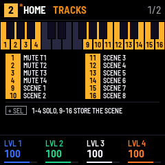

---

## 4. Quick start

A kick on track 1 and a melody on track 2, from a new project.

1. Press EDIT, then turn PRESET to the end, to the kit: the header says `PAD 1` and the scene shows the kit's three
   drums.
2. Press SEQ, then REC once. The header shows `GRID`: the white keys are now the 16 steps.
3. Press white keys 1, 5, 9 and 13. Each one becomes a step with the bass drum (pad 1).
4. Press PLAY. The kick plays four on the floor; the white keys light as the steps pass.
5. Turn ALGORITHM one notch to track 2, then press REC once more. The header shows `NOTES 1`: whatever you play is
   written at the cursor, which then moves on.
6. Play four notes. They fill steps 1 to 4, and you hear them as the loop comes round.
7. Press REC to disarm. Now try the knobs on EDIT, ENV and FX, or turn SEQ's SOURCE to another source.

---

## 5. Tracks, patterns and song

### Tracks

ALGORITHM picks the current track: the keys play it and the pages set it. HOME's TRACKS page shows the four tracks
on their pedestals, with the pattern each plays and its model, and its knobs are a mixer.

| Page | K1 | K2 | K3 | K4 |
| --- | --- | --- | --- | --- |
| TRACKS | LVL 1: track 1's level, 0–127 | LVL 2 | LVL 3 | LVL 4 |

To mute a track, hold HOME and press white key 1–4. A muted track's pedestal goes dark and its key goes out.

### Patterns

Each track has eight patterns, P1–P8. To pick one, hold SEQ and press white key 1–8, or turn PRESET on a STEP
pattern's pages. While playing, the new pattern starts when the one playing reaches the end of its loop; the header
shows `P1 > P2` meanwhile.

To clear the pattern shown, hold REC and press black key 1. To remove only its p-locks, hold REC and press black key 2.
Neither can be undone.

### Scenes

A scene keeps the pattern of each track and the mutes. Hold HOME and press white key 9–16 for scene 1–8:

- an empty scene stores what plays now;
- a stored scene comes back at once when stopped, and at the next bar while playing (the header shows `SCENE n`
  until then);
- with SEL held too, the scene is stored again over the old one.

The keys 9–16 are lit on HOME for the scenes in use.

### Song

The song is a list of up to 32 entries, each a scene played a number of times. Hold SAVE and press white key 1–8 to
add that scene at the end of the song. Then set it on HOME's SONG page:

| Knob | What it does | Range |
| --- | --- | --- |
| PRESET or K1 ENTRY | The entry shown. | 1 – the number of entries |
| K2 SCENE | The scene the entry plays. | 1–8 |
| K3 REPEAT | How many times it plays. | 1–16 |
| K4 MODE | PATTERN: PLAY starts the patterns as they are. SONG: PLAY starts at the first entry and goes through the list, then loops. | PATTERN, SONG |

An entry lasts its REPEAT times the length of its longest pattern, rounded up to whole bars. Press SEL on the SONG page
to remove the entry shown.

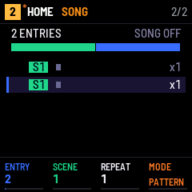

### New project

Hold SAVE and press black key 1: the header says `AGAIN: ERASE`. Press black key 1 again within three seconds to
replace the project with a new one. The old one is still in the FM-1 until you press SAVE.

---

## 6. Sound

Press EDIT. The ENGINE page sets the model's own four controls, SOUND picks the model and how it is played. PRESET
browses the models from any EDIT page.

| Page | K1 | K2 | K3 | K4 |
| --- | --- | --- | --- | --- |
| ENGINE | HARM, 0–127 | TIMB, 0–127 | MORPH, 0–127 | DECAY, 0–127 |
| SOUND | MODEL, by name, by family | TUNE, −24 to +24 semitones | GLIDE, 0–127 | POLY, 1–4 voices |

- **HARM, TIMB, MORPH** do something different on each model: the table below says what.
- **DECAY** sets how long a note rings after its gate closes, and the length of the model's own envelope on the models
  that have one (HEX A–C, WIRE, CHLADNI and the drums).
- **TUNE** transposes the track. **GLIDE** slides from one note to the next; 0 is off.
- **POLY** is how many notes the track plays at once. The four tracks share six voices; when they are all busy, a
  new note takes the oldest one.

The model's name shows in the header of ENGINE and SOUND, and under MODEL in SOUND's footer.

### Models

The models are Plaits' 24 synthesis models under QUARTZ's own names, sorted by family: PRESET goes through them in
the order of the table. Each family has its own scene.

| Family | Name | Sound | HARM | TIMB | MORPH | Plaits model |
| --- | --- | --- | --- | --- | --- | --- |
| Analog | CREST | Two classic analog waveforms | Detune | Pulse to sync | Triangle to saw | Virtual analog |
|  | SWEEP | Classic waves through a resonant filter | Resonance and filter slope | Cutoff | Waveform and sub | Virtual analog with VCF (1.2) |
|  | KINK | Phase distortion | Distortion frequency | Amount | Asymmetry | Phase distortion (1.2) |
|  | PRISM | A triangle shaped and folded | Waveshape | Fold | Asymmetry | Waveshaper |
| FM | MOON | Two sine operators | Ratio | Modulation index | Feedback | 2-operator FM |
|  | HEX A | 6-operator FM, basses and synths | Preset, 1 of 32 | Modulator levels | Envelope stretch | 6-op FM, bank 1 (1.2) |
|  | HEX B | 6-operator FM, keys, plucks, percussion | Preset | Modulator levels | Envelope stretch | 6-op FM, bank 2 (1.2) |
|  | HEX C | 6-operator FM, organs, pads, strings, brass | Preset | Modulator levels | Envelope stretch | 6-op FM, bank 3 (1.2) |
| Tables | PIPE | Wavetables, 4 banks of 8 x 8 | Bank | Row | Column | Wavetable |
|  | BOWL | A path read on a 2D terrain | Terrain | Path radius | Path offset | Wave terrain (1.2) |
| Spectral | FACETS | Harmonics added up | Spectral bumps | Main harmonic | Bump shape | Additive |
|  | POLLEN | Formants from sine segments | Formant ratio | Formant frequency | Width and shape | Granular formant |
| Chords | CHORALE | Four-note chords | Chord | Inversion | Waveform | Chords |
|  | ENSEMBLE | String machine with filter and chorus | Chord | Chorus and filter | Waveform | String machine (1.2) |
|  | ARCADE | Square-wave chords and arpeggios | Chord | Arpeggio or inversion | Pulse width, sync | Chiptune (1.2) |
| Voice | ORATOR | Vowels and words | Vowels, then word banks | Voice size | Phoneme or word | Speech |
| Noise | CROWD | Eight sawtooths in a swarm | Pitch spread | Density | Grain duration | Swarm |
|  | STATIC | Clocked noise through a filter | Low-pass to high-pass | Clock | Resonance | Filtered noise |
|  | GLITTER | Dust through resonators | Frequency spread | Density | Filter type | Particle noise |
| Physical | WIRE | A plucked string | Inharmonicity | Brightness | Decay | Inharmonic string |
|  | CHLADNI | A struck resonant body | Material | Brightness | Decay | Modal resonator |
| Drums | BASS DRUM | Analog bass drum | Attack and drive | Brightness | Decay | Bass drum |
|  | SNARE | Analog snare | Tone to noise | Drum modes | Decay | Snare drum |
|  | HI-HAT | Analog hi-hat | Metal to noise | High-pass | Decay | Hi-hat |
|  | KIT | 16 drum pads (below) | — | — | — | — |

On the drums, HEX A–C, WIRE and CHLADNI, the model makes its own envelope: ENV's ADSR then shapes only the filter.

The scenes, by family:

| Models | Scene |
| --- | --- |
| SWEEP, KINK, CREST, PRISM | A ship flies over crests that carry the waveform and fires at the next crest on each note. |
| HEX A–C, MOON | A cut planet with a ring; ships in orbit fire at it on each note, and MORPH tilts the ring. |
| BOWL, PIPE | A rider in a neon bowl (BOWL) or a half-pipe whose walls carry the wave (PIPE). |
| ENSEMBLE, CHORALE | A choir of androids, one per voice, on steps as high as their notes. |
| ARCADE | A cube robot hops from block to block, one block per note of the chord. |
| POLLEN, FACETS | A garden of crystal flowers, one per harmonic. |
| ORATOR | A low-poly head that speaks. |
| CROWD, STATIC, GLITTER | A neon dancefloor whose tiles the grains light. |
| WIRE | An acrobat on a laser rope that rings under each hop. |
| CHLADNI | A Chladni figure of the body's modes. |
| BASS DRUM, SNARE, HI-HAT, KIT | The kit's three drums, struck as they play. |

**Inspired by** [Plaits](https://pichenettes.github.io/mutable-instruments-documentation/modules/plaits/manual/)
by Mutable Instruments (Emilie Gillet), with the eight models of its
[firmware 1.2](https://pichenettes.github.io/mutable-instruments-documentation/modules/plaits/firmware/). QUARTZ runs
Plaits' own code. It adds to it what a module gets from its patch: notes and velocity from the keys and the
sequencer, up to four voices per track, GLIDE, an ADSR, a filter, an LFO, an arpeggiator and effects.

### KIT

KIT turns the track into 16 drum pads on the white keys. Each pad is one of Plaits' three drums (BD, SN or HH) with
its own tuning and settings, and a kit plays up to three pads at once. With KIT, EDIT has two pages:

| Page | K1 | K2 | K3 | K4 |
| --- | --- | --- | --- | --- |
| PAD | TUNE, −24 to +24 | HARM, 0–127 | TIMB, 0–127 | DECAY, 0–127 |
| KIT | MODEL, by name | ENGINE, BD SN HH | LEVEL, 0–127 | — |

The knobs set the last pad played, named in the header (`PAD 1`). In EDIT, hold a pad: K1–K4 set that pad and PRESET
changes its engine. KIT's scene is the 16 pads, each with its engine, the one the knobs set lit.

| Pad | 1 | 2 | 3 | 4 | 5 | 6 | 7 | 8 |
| --- | --- | --- | --- | --- | --- | --- | --- | --- |
| Default | Bass drum | Snare | Closed hat | Open hat | Rim | Clap | Low tom | Mid tom |
| **Pad** | **9** | **10** | **11** | **12** | **13** | **14** | **15** | **16** |
| Default | High tom | Bass drum 2 | Snare 2 | Closed hat 2 | Conga | Cowbell | Shaker | Ride |

---

## 7. Shaping

Each voice goes through Plaits' low-pass gate, which follows the envelope, then a filter. The track then goes through
its insert effect, its level and its pan, and sends to the shared delay and reverb. Everything on these pages is per
track. The scenes show the model's name and draw what the knobs set.

### ENV

| Page | K1 | K2 | K3 | K4 |
| --- | --- | --- | --- | --- |
| ADSR | ATTACK | DECAY | SUSTAIN | RELEASE |
| FILTER | TYPE: LP, HP, BP | CUTOFF | RES | ENV AMT, −64 to +63 |

- ATTACK, DECAY and RELEASE go from 1 ms to 10 s. SUSTAIN is the level held while the note is on.
- The ADSR sets the voice's level, scaled by the velocity. On the models with their own envelope (HEX A–C, WIRE,
  CHLADNI, the drums and the KIT), it only moves the filter.
- CUTOFF goes from 20 Hz to 20 kHz; 127 on LP lets everything through. RES goes up to the edge of self-oscillation.
- ENV AMT is how far the ADSR moves the cutoff, up to eight octaves either way. An accented step moves it 1.5 times as
  far (section 8).

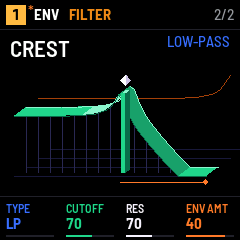

### LFO

| Page | K1 | K2 | K3 | K4 |
| --- | --- | --- | --- | --- |
| LFO | SHAPE: SIN, TRI, SAW, SQR, S&H | RATE | DEPTH, −64 to +63 | DEST |

- RATE first offers 12 speeds in time with the tempo (8 BAR, 4 BAR, 2 BAR, 1 BAR, 1/2, 1/4, 1/4T, 1/8, 1/8T, 1/16,
  1/16T, 1/32), then free speeds from 0.05 Hz to 30 Hz.
- DEST: HARM, TIMB, MORPH, PITCH (±12 semitones), CUTOFF (±5 octaves), RES or LEVEL. The LFO adds to the value set
  on the page, or to its p-lock.
- PRESET switches FREE and TRIG, shown in the header. FREE runs on its own, and a synced rate starts with the bar at
  PLAY. TRIG starts the shape again on each note.
- S&H takes a new random value each cycle.

### ARP

| Page | K1 | K2 | K3 | K4 |
| --- | --- | --- | --- | --- |
| ARP | MODE: OFF, UP, DOWN, UP-DN, RAND, ORDER | OCT, 1–4 | DIV, 1/32 to 1/1 | GATE, 5–100 % |

- The arpeggiator plays the notes held, from the keys or from the steps: a chord on a step is arpeggiated for as long
  as the step lasts. A single note is repeated, over OCT octaves.
- UP-DN does not repeat the top and bottom notes. ORDER follows the order the notes came in.
- It runs at its own DIV, in time with the tempo but without swing. GATE is how long each note lasts.
- **Latch**: hold ARP and press keys. Their notes stay in the arpeggio after you let go, until you press a key without
  ARP.
- A KIT track ignores the arpeggiator.

### FX

| Page | K1 | K2 | K3 | K4 |
| --- | --- | --- | --- | --- |
| MIX | DELAY send | REVERB send | PAN, −64 to +63 | LEVEL |
| INSERT | depends on the type | depends on the type | depends on the type | MIX |

On INSERT, PRESET picks the insert's type, shown as the page's name. K4 MIX blends it with the dry sound: 0 is dry
only, 127 is the effect only. The three other knobs keep their values when you change the type.

WAVEFOLD starts almost clean at FOLD 0 and folds more as you turn it; its level follows the dry sound's, so folding
changes the tone, not the volume. BIAS makes the folds uneven.

| Type | K1 | K2 | K3 |
| --- | --- | --- | --- |
| INSERT OFF | — | — | — |
| OVERDRIVE | DRIVE | TONE | — |
| WAVEFOLD | FOLD | BIAS | TONE |
| BITCRUSH | BITS, 16 to 2 | RATE, 44.1 kHz to 500 Hz | — |
| CHORUS | RATE, 0.05 to 5 Hz | DEPTH | — |
| PHASER | RATE, 0.05 to 5 Hz | DEPTH | FEEDBK |
| RING MOD | FREQ, 20 Hz to 5 kHz | — | — |
| COMB | NOTE, F1 and up | FEEDBK | DAMP |

The delay and the reverb are shared by the four tracks; DELAY and REVERB set how much of the track goes to each.
They are set on GLO's FX page (section 10): the delay is a ping-pong in time with the tempo, the reverb is Clouds'.

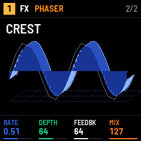

### Punch-ins

Hold FX and press white keys: each one is an effect on the whole mix, for as long as you hold its key. Several can
be held together. Its name shows in the header; let go of FX and they all stop.

| Key | Punch-in | What it does |
| --- | --- | --- |
| 1–4 | LOOP 1/8, LOOP 1/12, LOOP 1/16, LOOP 1/32 | Repeats the last slice of that length, started on the beat grid. |
| 5 | TAPE STOP | Slows down to a stop over a beat, pitch falling, then silence. |
| 6 | LOW-PASS | A low-pass at 400 Hz. |
| 7 | HIGH-PASS | A high-pass at 1.5 kHz. |
| 8 | SWEEP | A resonant low-pass sweeping down and up once a bar. |
| 9 | BITCRUSH | 6 bits. |
| 10 | DOWNSAMPLE | 4 kHz. |
| 11 | GATE 1/16 | Cuts every other sixteenth. |
| 12 | AUTO-PAN | Left to right and back once a beat. |
| 13 | DELAY THROW | Sends the whole mix into the delay; the echoes go on after you let go. |
| 14 | FREEZE | Holds the reverb's tail; it fades when you let go. |
| 15 | STUTTER | Repeats faster each beat: 1/8, 1/16, 1/32, then 1/64. |
| 16 | STUT GATE | Repeats 1/64 slices, each cut in half. |

While recording LIVE on a STEP pattern, the punch-ins you hold are written on the steps they cross (section 8), and
play back with the pattern.

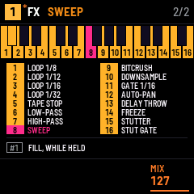

**Inspired by** the [OP-Z's punch-in effects](https://teenage.engineering/guides/op-z/punch-in-effects): a held key
for a momentary effect on the mix, recorded with the pattern. QUARTZ's are its own set of sixteen. The reverb is
[Clouds'](https://pichenettes.github.io/mutable-instruments-documentation/modules/clouds/manual/) by Mutable
Instruments.

---

## 8. Sequencer

This section is about STEP patterns, the ones you write yourself. Press SEQ: the STEPS page shows the pattern's
current page of 16 steps as blocks on a 4 x 4 plateau, each with its note on top and as high as its velocity.

| Page | K1 | K2 | K3 | K4 |
| --- | --- | --- | --- | --- |
| STEPS | LEN, 1–64 steps | DIV, 1/32 to 1/1 | PATH | SOURCE |
| XY (PATH XY only) | X LEN, 1–4 | X DIV | Y LEN, 1–4 | Y DIV |

- **LEN** is the pattern's length, **DIV** the length of a step. The DIVs are 1/32, 1/16T, 1/16, 1/8T, 1/8, 1/4T,
  1/4, 1/2 and 1/1; T is a triplet.
- **SOURCE** changes where the pattern's notes come from (section 9). Each pattern keeps its own steps whatever its
  source.
- **PATH** is the order the steps play in. A path draws itself on the plateau as arrows. With a LEN under 16, a
  path takes its first LEN places: SNAKE, COLUMNS and SPIRAL can reach a step beyond LEN, and the plateau lights the
  steps the path plays.

| PATH | Order |
| --- | --- |
| FWD | 1 to LEN. |
| REV | LEN back to 1. |
| PING-PONG | Forwards then backwards, without repeating the ends. |
| SNAKE | Each page's rows of four, every other row backwards. |
| COLUMNS | Each page's 4 x 4 grid, column by column. |
| SPIRAL | Each page's 4 x 4 grid, in a spiral from the corner to the centre. |
| RANDOM | A random step each time. |
| XY | Two clocks on the 4 x 4 grid: X walks along a row at X DIV, over X LEN steps; Y moves to the next row at Y DIV, over Y LEN rows. |

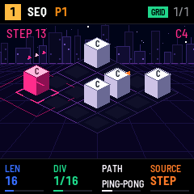

### Playing, writing, recording

Without REC, the keys play the track, in SEQ too: you can look for an idea while the pattern plays. REC makes them
write, in one of three ways. Short presses on REC go round:

| Where | Short presses on REC |
| --- | --- |
| SEQ, a STEP pattern | off, GRID, NOTES, off |
| Other domains | off, NOTES (LIVE while playing), off |

- **GRID**: the 16 white keys are the 16 steps of the page.
- **NOTES**: a cursor walks through the pattern; the keys write the notes of the step under it.
- **LIVE**: what you play is recorded where it falls, while the pattern plays. Hold REC and press PLAY.

PLAY starts and stops. In GRID and NOTES there is no count-in, and stopping keeps the mode; stopping ends LIVE.

The keys play at a fixed velocity of 100; set a step's velocity afterwards. The last note or chord you played without
REC (keys held together) goes to the *clipboard*, ready to paste on a step. The clipboard is shared by the four
tracks; at the start it holds C4, and on a kit a pasted note becomes pad 1.

### GRID

In SEQ, press REC once. The white keys are the steps of the page shown; OCT- and OCT+ turn the page (1–16, 17–32…).
It works stopped or playing. A short press is a press released with nothing turned meanwhile.

- A short press on an empty step pastes the clipboard on it.
- A short press on a lit step cuts it: its content goes to the clipboard and the step is emptied.
- To move a step, cut it, then press where it goes. To copy it, cut it, then paste it back and on every other step.

The clipboard holds a whole step: notes, velocity, length, functions and p-locks.

### A held step

| While a step is held | Effect |
| --- | --- |
| nothing (stopped) | The step sounds. |
| white keys | Write its notes, a chord up to POLY (the natural notes; for sharps, use NOTES). On a kit, they add or remove pads, four at most. |
| black keys | Pick a function (below); 6 and 7 switch SLIDE and ACCENT. |
| PRESET | Sets the function picked (VEL first). |
| OCT+ / OCT- | Its length: one step more or less, up to 8 steps. A step written by hand lasts half a step, so the first notch ties it to the next one. |
| K1–K4 | P-locks of the page shown (below). |
| SELECT | Turns the p-lock pages. |

The plateau lifts the held step and shows its functions beside it. A long note draws a green band on the floor
towards the steps it covers, filled in pink while it sounds.

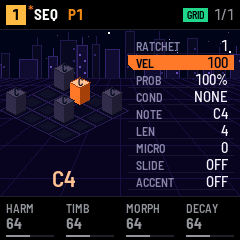

### Step functions

Each black key carries a family of functions: a press picks its first function, another press the next one. PRESET
sets it. Black keys 6 and 7 are different: they switch SLIDE and ACCENT on or off at once, and PRESET goes on setting
the function picked before.

| Black key | Function | Values |
| --- | --- | --- |
| 1 | RATCHET | 1–4: the step's notes repeated within the step. |
| 2 | VEL | 1–127. |
| 3 | PROB, then COND | PROB: 0–100 %, by 5 %. COND: below. |
| 4 | NOTE | The step's note, the whole chord moving with it. |
| 5 | LEN, then MICRO | LEN: in eighths of a step, up to 8 steps. MICRO: −11 to +11, in 24ths of a step, early or late. |
| 6 | SLIDE | On or off: the note is tied to the next step's, which plays without a new attack (and glides to it with GLIDE). |
| 7 | ACCENT | On or off: the velocity goes up by 32 and the envelope moves the filter 1.5 times as far. |
| 8–11 | — | Kept for later. |

COND decides on which loops the step plays, before PROB:

| COND | The step plays… |
| --- | --- |
| NONE | Always (then PROB decides). |
| FIRST | On the first loop only, after PLAY or a pattern change. |
| !FIRST | On every loop but the first. |
| PRE | If the last step with a condition or a PROB on this track played. |
| !PRE | If it did not. |
| A:B | On loop A of every B: 1:2 every other loop from the first, 2:4 the second loop of four… B goes from 2 to 8. |

For example: hold a step, press black key 3 for PROB, press it again for COND, turn PRESET to 1:2.

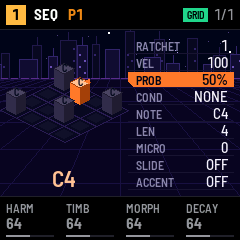

### P-locks

While a step is held, K1–K4 lock the knobs of a sound page to that step only: the step plays with its own value, the
others with the page's. SELECT turns the pages: ENGINE, SOUND, ADSR, FILTER, LFO, INSERT, MIX, ARP (a kit: ADSR,
FILTER, LFO, INSERT, MIX). A pattern holds up to 128 p-locks; past that, the header says `LOCKS FULL`.

### Several steps at once

Hold SEL and press steps: each press adds the step to the selection or takes it out, without switching it on or
off. The first one is the reference, whose functions are shown. Still holding SEL:

- a black key and PRESET: every step takes the reference's value, as you turn it (all at PROB 50 %, say);
- black key 6 or 7: SLIDE or ACCENT switches on the reference, and every step takes its new value;
- K1–K4: the same p-lock on every step;
- OCT+ / OCT-: each step one step longer or shorter.

Letting go of SEL clears the selection.

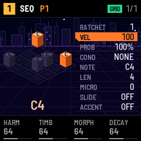

### NOTES

In SEQ, press REC twice (once in other domains). Every key is a note, black keys included, and the header shows
`NOTES` with the cursor's step. The keys light the notes already on that step.

- **Move the cursor** with PRESET, across the whole pattern; the plateau turns its page by itself. Hold SEL and press
  white key *n* to jump to step *n* of the page.
- **Play a note or a chord** to write it. On an empty step, the step is made (velocity 100, half a step long). On a lit
  step, only the notes change: velocity, length, functions and p-locks stay.
- The cursor moves on by the step's length when you let go of the last key. To fix a mistake, PRESET one notch back
  and play again.
- **A long note**: hold the key and turn PRESET, one step a notch.
- **A rest**: turn PRESET one notch without a key.
- **Set the step under the cursor** with K1–K4 directly, on three pages before STEPS (SELECT turns them). Turning a
  knob on an empty step makes it.
- Its p-locks: hold SEL and turn K1–K4; SEL and SELECT for the p-lock page.

| NOTES page | K1 | K2 | K3 | K4 |
| --- | --- | --- | --- | --- |
| 1 | NOTE, the whole chord | LEN | VEL | PROB |
| 2 | RATCHET | COND | MICRO | — |
| 3 | SLIDE | ACCENT | — | — |

SLIDE and ACCENT: right is on, left is off. In SEQ, NOTES works while playing too, and stopping keeps it. Out of SEQ,
it works stopped; PLAY then switches to LIVE (with the count-in if CLICK has one). While NOTES is on, PRESET moves
the cursor and changes neither the pattern, the model nor the insert.

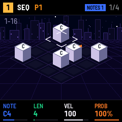

### LIVE

- **Playing**: hold REC and press PLAY; the pattern keeps playing. Out of SEQ, arming REC while playing is enough.
- **Stopped, with a count-in** (GLO SCALE, CLICK at COUNT or BOTH): hold REC and press PLAY. A bar of count-in, then
  the recording.
- **Stopped, without**: hold REC and press PLAY to arm (`ARM`). The first note starts the pattern on step 1.

Notes are recorded with GLO's QUANT (OFF, 50 %, 100 %: how far they are pulled to the step), the knobs you turn
become p-locks, and the punch-ins you hold are written on the steps they cross.

To erase while playing:

- hold REC and press keys: they don't sound, and their notes are taken off the steps the pattern crosses;
- hold REC and OCT-: every step crossed is cleared.

REC (short) disarms and the pattern keeps playing. PLAY stops and disarms.

### REC held

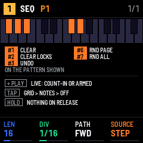

| REC held + | Not in LIVE or ARM | In LIVE |
| --- | --- | --- |
| PLAY | LIVE, with the count-in or armed | — |
| black key 1 | CLEAR: empties the pattern shown | — |
| black key 2 | CLEAR LOCKS: removes its p-locks | — |
| keys | — | erase their notes as the pattern crosses them |
| OCT- | — | clears every step crossed |

A CLEAR cannot be undone.

### Recipes

| I want to… | I do… |
| --- | --- |
| put a kick on the four beats | Play the kick pad without REC, then SEQ, REC (GRID), and press steps 1, 5, 9, 13. |
| enter a melody note by note | SEQ, REC twice (NOTES), play; PRESET for a rest, a key held + PRESET for a long note. |
| write a chord with sharps | NOTES, cursor on the step, play the chord. |
| change a step's notes, keep its settings | NOTES, cursor on the step, play the new notes. |
| move a step | GRID: press it (cut), then press where it goes. |
| hold a note three steps | GRID: hold the step, OCT+ twice. |
| push a note late by 1/24 | Hold the step, black key 5 twice (MICRO), PRESET. |
| set four steps to 50 % | GRID, hold SEL, press the four steps, black key 3 (PROB), PRESET. |
| record as I play, no count-in | Stopped: hold REC, press PLAY, then play: the pattern starts with the first note. |
| remove a wrong hi-hat while playing | In LIVE, hold REC and the hi-hat's key while the pattern passes it. |
| empty the pattern | Hold REC, press black key 1. |
| find a shortcut | Hold the button: its map shows. |

**Inspired by** Elektron's sequencers ([Digitakt manual](https://www.elektron.se/support-downloads/digitakt)):
the 16 keys as the steps, parameter locks, trig conditions (A:B, 1ST, PRE and their negations) and micro timing.
QUARTZ's COND has no FILL or NEI, and its PROB is a function of its own beside COND. The gestures around the
clipboard (paste the last note, cut to move, hold to hear) and SEL as a shift come from the
[OP-Z](https://teenage.engineering/guides/op-z).

---

## 9. Sources

Each pattern has a source: where its notes come from. SOURCE is always K4 of SEQ's first page, so you change it with
the same knob whatever the source. A pattern keeps its steps and the settings of every source, so you can go back.
A scene can switch a track from one source to another, since each pattern has its own.

| Source | In a word |
| --- | --- |
| STEP | The step sequencer (section 8). |
| ATLAS | A map of drum rhythms. |
| FLEET | Random rhythms and melodies, which can loop. |
| COLONY | The Game of Life, read as notes. |
| LOOM | Five loops of different lengths: trigger, note, octave, length, velocity. |
| CADENCE | A chord progression. |
| LATTICE | A walk from chord to chord on the Tonnetz. |
| MOONS | Moons on orbits, each playing as it passes. |
| IMPROV | An improviser that learns a phrase from you. |

What the generative sources (all but STEP) share:

- They play at the pattern's DIV, with the project's swing. Their notes go through the arpeggiator, the mutes and
  the scenes like a STEP pattern's.
- A loop is 16 steps (ATLAS 32, FLEET its LEN): a pattern change waits for its end, and a song entry counts it.
- Without REC, the keys play the track. REC writes nothing in them, except LOOM, CADENCE and LATTICE, which have a
  GRID of their own, and IMPROV, which listens.
- PRESET always does something useful for the source: each subsection says what.
- On a synth track, setting SOURCE to CADENCE, LATTICE, MOONS or IMPROV raises POLY to 3 if it is lower, so their
  chords sound.
- COLONY, LOOM, CADENCE, LATTICE and MOONS count in degrees of GLO's scale, up from their NOTE brought into the
  scale. FLEET has its own allowed notes; ATLAS plays a fixed NOTE; IMPROV plays the notes it learnt.

### STEP

The pattern you write yourself: see section 8. PRESET picks the pattern; on a held step, it sets the step's function.

### ATLAS

A map of 25 drum rhythms of 32 steps, each with three parts (bass drum, snare, hi-hat). X and Y pick a place on the
map, between the rhythms, and each part's density thins it out or fills it in.

| Page | K1 | K2 | K3 | K4 |
| --- | --- | --- | --- | --- |
| ATLAS | DIV | VOICE, 1–3 | NOTE | SOURCE |
| MAP | X, 0–127 | Y, 0–127 | CHAOS, 0–127 | — |
| DENS | DENS 1 | DENS 2 | DENS 3 | — |

- On a kit, the three parts play pads 1, 2 and 3. On a synth track, only the part VOICE plays, at the note NOTE.
- CHAOS shakes the densities at the start of each loop: rolls and ghost notes come and go.
- Accented hits play at full velocity.
- **PRESET** steps through the 25 rhythms of the map, setting X and Y on them.

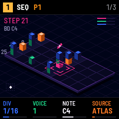

**Inspired by** [Grids](https://pichenettes.github.io/mutable-instruments-documentation/modules/grids/manual/) by
Mutable Instruments: QUARTZ runs Grids' drum map and its pattern generator. Grids' Euclidean mode and its own clock
are not there.

### FLEET

Random rhythms and random notes, which DEJA VU turns into loops. The T section decides when notes play, the X
section which notes.

| Page | K1 | K2 | K3 | K4 |
| --- | --- | --- | --- | --- |
| FLEET | DIV | T OUT, 1–3 | LEN, 1–16 | SOURCE |
| T | MODE | BIAS | JITTER | DEJA VU |
| X | SPREAD | X BIAS | STEPS | — |
| NOTES | NOTE | RANGE, 1–4 octaves | — | — |

- **T**: each step, t2 plays and t1 and t3 are drawn by MODE: C.BERN (one or the other, a coin toss), CLUSTERS,
  DRUMS (patterns like a kick and a snare), I.BERN (each its own coin), DIVIDER, 3 STATES, MARKOV. BIAS leans towards
  t1 or t3; JITTER shifts the notes in time, up to almost half a step.
- **X**: each note is drawn between NOTE and RANGE octaves above it. SPREAD sets how widely, X BIAS leans low or
  high, and STEPS keeps only the strongest notes of the scale as it goes up (the tonic, then the fifth, the third…).
- **DEJA VU**: at 0, every draw is new. Towards the middle, the draws repeat as a loop of LEN steps; above, the loop
  is played in a shuffled order.
- **NOTES** page: the keys switch the notes FLEET may play on and off, in any octave; the scene shows the 12 notes.
  By default they are the project's scale.
- On a kit, t1, t2 and t3 play pads 1, 2 and 3. On a synth track, only the output T OUT plays.
- GLO's KEYS at FLEET makes the white keys play the allowed notes on FLEET tracks.
- **PRESET** draws new loops, at once.

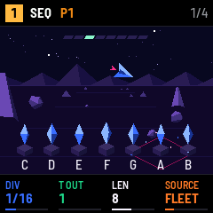

**Inspired by** [Marbles](https://pichenettes.github.io/mutable-instruments-documentation/modules/marbles/manual/)
by Mutable Instruments: QUARTZ runs Marbles' t models, its X draws and its DEJA VU, one step at a time. LEN is the
loop's length here, 1–16; the X outputs play one at a time, and Marbles' ramps and external clock are not there.

### COLONY

A grid of 16 x 8 cells living by the Game of Life. A head reads one column a step, from left to right; the living
cells of the column play, from the bottom up. Every few loops, the grid moves on by a generation.

| Page | K1 | K2 | K3 | K4 |
| --- | --- | --- | --- | --- |
| COLONY | DIV | POLY, 1–4 | NOTE (a kit: MAP) | SOURCE |
| SEED | SEED, 0–127 | DENS, 0–127 | AUTO, OFF ON | — |
| EVOL | GEN, 1 2 4 8 | MUT, 0–127 | — | — |

- A row is a degree of the scale above NOTE; on a kit, MAP PADS plays pad 1–8 by row, and MAP BANDS plays pads 1, 2
  and 3 for the bottom, middle and top rows. POLY is how many cells of a column play, at most (three on a kit).
- **SEED** and DENS make the grid you start from: the same pair always gives the same grid. Turning either sows a new
  grid at the next loop. STOP then PLAY starts again from it.
- **GEN** is how many loops between two generations; **MUT** adds random cells at each one.
- A grid that dies or freezes, with MUT at 0: AUTO ON sows a new one; OFF leaves it.
- Cells born at the last generation play accented.
- **PRESET** turns SEED: a new grid at the next loop.

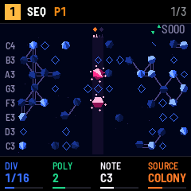

**Inspired by** [Conway's Game of Life](https://en.wikipedia.org/wiki/Conway%27s_Game_of_Life) (John Horton Conway,
1970): a cell is born with three living neighbours and lives on with two or three.

### LOOM

Five lanes, TRIG, NOTE, OCT, DUR and VEL, each a loop of 1 to 16 cells with its own length. All the heads move one
cell a step; with different lengths they drift apart, and the melody takes a long time to come back.

| Page | K1 | K2 | K3 | K4 |
| --- | --- | --- | --- | --- |
| LOOM | DIV | NOTE | TRIG LEN, 1–16 | SOURCE |
| LENS | NOTE LEN | OCT LEN | DUR LEN | VEL LEN |

| Lane | Values | What a cell does |
| --- | --- | --- |
| TRIG | off, on | A note plays or not. |
| NOTE | 0–15 | Degrees of the scale above NOTE; on a kit, the pad 1–16. |
| OCT | 0–4 | −2 to +2 octaves (not on a kit). |
| DUR | 0–4 | ¼, ½, 1, 2 or 4 steps. |
| VEL | 0–3 | Velocity 40, 70, 100, or 100 accented. |

- **PRESET** picks the lane you edit; the scene shows it big, the five lanes small above.
- **GRID**: in SEQ, REC once. The white keys are the edited lane's cells: a short press switches a TRIG on or off, or
  raises another lane's value by one (back to 0 after the top). Hold a cell and turn K1 to set it; hold a NOTE cell
  and press another key to write that note. Hold a cell 0.4 s for its help.
- The keys light the cells set, and the lane's head.

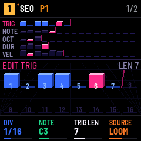

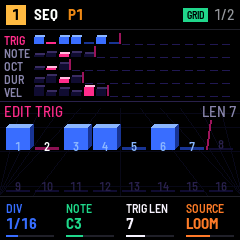

**Inspired by** [Kria](https://monome.org/docs/ansible/kria/) by monome (for Ansible and the grid): a step sequencer
whose trigger, note, octave and duration have loops of their own lengths. LOOM adds a velocity lane, and its lanes are
always independent.

### CADENCE

A progression of 1 to 8 chords, one a bar (16 steps), in degrees of the project's scale. Major, minor or diminished
come from the scale. A new pattern plays I – vi – IV – V.

| Page | K1 | K2 | K3 | K4 |
| --- | --- | --- | --- | --- |
| CADENCE | DIV | NOTE | RATE: 1/BAR to 16/BAR | SOURCE |
| PROG | LEN, 1–8 | STRUM, 0–7 | VOICE: ROOT, SMOOTH | — |
| CHORD | DEGREE: I–VII | SIZE: TRIAD, SEVENTH, SUS2, SUS4 | — | — |

- RATE is how many times the chord is struck in a bar; each strike lasts until the next, and the first of the bar is
  accented.
- STRUM spreads the notes from the lowest up, by 24ths of a step; 0 plays them together.
- VOICE ROOT plays each chord in root position on NOTE. SMOOTH picks the inversion closest to the chord before, never
  far from the root position.
- The chord plays as many notes as POLY: the root, the third, the seventh, then the fifth.
- **PRESET** moves a cursor along the chords; the CHORD page sets the one under it, and the scene shows it.
- **GRID**: in SEQ, REC once. White keys 1–8 are the chords: a short press gives the next size; hold one and press a
  note of the scale to give it that degree, or turn K1 (degree) and K2 (size).
- On a kit, CADENCE plays nothing.

CADENCE is QUARTZ's own.

### LATTICE

A chord a bar, which moves on the Tonnetz: each step of a sequence of up to 8 transforms the chord by P, L or R, and
each keeps two of its three notes, so the chords always flow.

| Page | K1 | K2 | K3 | K4 |
| --- | --- | --- | --- | --- |
| LATTICE | DIV | NOTE | RATE: 1/BAR to 16/BAR | SOURCE |
| WALK | LEN, 1–8 | CHAOS, 0–127 | SCALE: FREE, IN SCALE | RETURN: OFF, ON |
| PLAY | STRUM, 0–7 | VOICE: ROOT, SMOOTH | — | — |
| STEP | OP: –, P, L, R | — | — | — |

- **P** (parallel) swaps major and minor on the same root: C ↔ Cm. **L** (leading tone) moves the root by a
  semitone: C ↔ Em. **R** (relative): C ↔ Am. **–** keeps the chord.
- It starts on the triad of the scale on NOTE. RETURN ON goes back to it after the sequence, so the walk loops; OFF
  walks on.
- CHAOS is the chance that a step uses another transformation than the one written.
- IN SCALE keeps every chord in GLO's scale, trying the other transformations; FREE lets the walk leave it.
- RATE, STRUM and VOICE play the chord as in CADENCE.
- **PRESET** moves a cursor along the steps; the STEP page sets the one under it.
- **GRID**: in SEQ, REC once. White keys 1–8 are the steps: a short press gives the next one (–, P, L, R); hold one
  and press black key 1–4 for P, L, R or –, or turn K1.
- On a kit, LATTICE plays nothing.

**Inspired by** the [Tonnetz](https://en.wikipedia.org/wiki/Tonnetz) (Leonhard Euler, 1739) and the
[neo-Riemannian](https://en.wikipedia.org/wiki/Neo-Riemannian_theory) transformations P, L and R (David Lewin,
Richard Cohn).

### MOONS

One to four moons on orbits around a planet. Each moon goes round in PERIOD steps and plays its note each time it
passes the top. Moons with different periods meet now and then: those meetings play accented.

| Page | K1 | K2 | K3 | K4 |
| --- | --- | --- | --- | --- |
| MOONS | DIV | NOTE | MOONS, 1–4 | SOURCE |
| MOON | PERIOD, 1–32 | PHASE, 0–31 | NOTE, degree 0–15 (a kit: PAD 1–16) | — |

- A moon's note is degrees of the scale above NOTE; on a kit, its pad.
- PHASE shifts the moon along its orbit, so two moons with the same period can play one after the other.
- A new pattern has three moons, periods 8, 6 and 5, playing C, E and G: they meet again every 120 steps.
- The white keys 1–4 light as their moon passes.
- **PRESET** picks the moon the MOON page sets; the scene frames it.

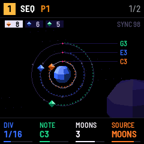

MOONS is QUARTZ's own. Orbit sequencers such as [Aphelian](https://apps.apple.com/app/aphelian/id1435855056) play
with the same image.

### IMPROV

You play a phrase, IMPROV improvises on it: it picks a place in the phrase where the last notes it played appear, and
goes on from there. The result sounds like your phrase, rearranged.

| Page | K1 | K2 | K3 | K4 |
| --- | --- | --- | --- | --- |
| IMPROV | DIV | ORDER, 1–2 | DRIFT, 0–127 | SOURCE |
| LOOP | LOOP: FREE, 1–16 | — | — | — |

- **LISTEN**: in SEQ, press REC once. IMPROV goes quiet, the header shows `LISTEN`, and every note you play is learnt,
  with the time until the next one (up to 7 steps; notes played together make a chord). The first note clears the old
  phrase; the phrase keeps the last 32 notes. Press REC again to stop: the time since the last note becomes its gap.
  Changing pattern, track, source or domain stops LISTEN too.
- **ORDER** 1 matches the last note played, 2 the last two (more like the phrase).
- **DRIFT** is the chance of jumping anywhere in the phrase instead.
- **LOOP** 1–16 starts the improvisation again every LOOP steps, the same way each time: a riff. FREE never repeats.
- The white keys 1–8 show where in the phrase IMPROV is reading, in eighths; in LISTEN, how full the phrase is.
- A new pattern knows C4 D4 E4 G4 E4 D4 C4.
- **PRESET** draws again: another improvisation from the same phrase, at once.

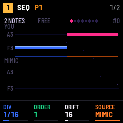

**Inspired by** the [Continuator](https://www.francoispachet.fr/?p=4360) by François Pachet (Sony CSL, 2003), which
learns a musician's phrases as they play and answers in their style. IMPROV learns one phrase, with ORDER 1 or 2.

---

## 10. Global

Press GLO for the project's settings, shared by the four tracks.

| Page | K1 | K2 | K3 | K4 |
| --- | --- | --- | --- | --- |
| TEMPO | TEMPO, 40–240 BPM | SWING, 50–75 % | COMP, 0–127 | DUCK, 0–127 |
| SCALE | TONIC, C to B | MODE | QUANT: OFF, 50 %, 100 % | CLICK: OFF, METRO, COUNT, BOTH |
| KEYS | IN SCALE: OFF, FLEET, ALL | — | — | — |
| FX | DLY TIME, 1/32 to 1/1 | DLY FB | REV SIZE | REV TONE |
| CPU | — | — | — | — |

- **SWING** delays every other step; 50 % is straight.
- **COMP** compresses the whole mix; 0 is off. A limiter always protects the output.
- **DUCK** lowers the synth tracks and the effects on each bass drum pad of a KIT track, up to −24 dB, like a
  sidechain; 0 is off.
- **TONIC** and **MODE** make the project's scale. The generative sources count their degrees in it, FLEET starts
  from it, and KEYS plays it. MODE: CHROM, MAJOR, MINOR, DORIAN, PHRYG, LYDIAN, MIXO, LOCRIAN, HARM MIN, PENTA,
  MIN PENTA.
- **QUANT** pulls the notes recorded in LIVE onto the steps: OFF keeps your timing, 100 % puts them on the step.
- **CLICK**: METRO plays a click while recording LIVE, COUNT a bar of count-in before LIVE, BOTH both.
- **KEYS**: OFF, the keys are a chromatic keyboard. ALL: on every synth track, the white keys play the scale up from
  the tonic and the black keys are silent. FLEET: the same on FLEET tracks only, with their allowed notes. A kit keeps
  its pads: on a KIT track, the page numbers the white keys 1–16 and crosses out the black ones. The keys you hold
  light up pink.
- **FX**: the shared ping-pong delay, its time in steps of the tempo and its feedback; the reverb's size and its
  tone (how much of the highs it keeps).
- **CPU** shows each core's load, LOST BLOCKS (audio blocks the FM-1 could not compute in time: you hear them as
  clicks), the voices in use, the effects' share and the screen's frame rate.

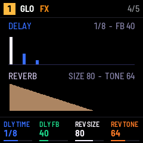

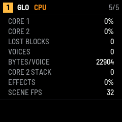

---

## 11. Saving

QUARTZ keeps one project: the four tracks, their patterns and sounds, the scenes, the song and the global settings.

- Press SAVE while stopped to write it to the FM-1. The FM-1 loads it when it starts.
- While playing, SAVE only shows `STOP TO SAVE`: writing to the flash would stall the sound.
- Nothing is saved on its own: turning the FM-1 off loses what changed since the last SAVE.
- A new project (SAVE held, black key 1 twice) replaces the one in memory; the saved one stays until the next SAVE.

---

## 12. Credits and inspirations

QUARTZ is made by f0nski. It stands on the work of others: code it runs, and ideas it borrows.

| QUARTZ | Origin | By | Licence | Link |
| --- | --- | --- | --- | --- |
| The 24 models | Plaits, with firmware 1.2's models | Mutable Instruments (Emilie Gillet) | MIT | [manual](https://pichenettes.github.io/mutable-instruments-documentation/modules/plaits/manual/) |
| ATLAS | Grids' drum map and pattern generator | Mutable Instruments (Emilie Gillet) | GPL-3.0 | [manual](https://pichenettes.github.io/mutable-instruments-documentation/modules/grids/manual/) |
| FLEET | Marbles' t models, X draws and DEJA VU | Mutable Instruments (Emilie Gillet) | MIT | [manual](https://pichenettes.github.io/mutable-instruments-documentation/modules/marbles/manual/) |
| The reverb | Clouds' reverb | Mutable Instruments (Emilie Gillet) | MIT | [manual](https://pichenettes.github.io/mutable-instruments-documentation/modules/clouds/manual/) |
| COLONY | The Game of Life (idea) | John Horton Conway, 1970 | — | [Wikipedia](https://en.wikipedia.org/wiki/Conway%27s_Game_of_Life) |
| LOOM | Kria (idea) | monome | — | [docs](https://monome.org/docs/ansible/kria/) |
| LATTICE | The Tonnetz and neo-Riemannian theory (idea) | Leonhard Euler; David Lewin, Richard Cohn | — | [Wikipedia](https://en.wikipedia.org/wiki/Neo-Riemannian_theory) |
| IMPROV | The Continuator (idea) | François Pachet, Sony CSL, 2003 | — | [paper](https://www.francoispachet.fr/?p=4360) |
| Step functions | Parameter locks, trig conditions, micro timing (idea) | Elektron | — | [Digitakt](https://www.elektron.se/support-downloads/digitakt) |
| Domains, held-button maps, punch-ins, this guide's shape | The OP-Z (idea) | teenage engineering | — | [guide](https://teenage.engineering/guides/op-z) |
| CADENCE, MOONS, the scenes | QUARTZ's own | f0nski | GPL-3.0 | — |
| The platform | fm1-base, on felucca-bsp | Charles Vestal; Leo Kuroshita (Hügelton Instruments) | MPL-2.0 | [fm1-base](https://github.com/charlesvestal/fm1-base) |

QUARTZ itself is free software under the GPL-3.0-or-later; its [source](https://github.com/F0nski/quartz) holds the
licences of each part. M-VAVE and FM-1 are trademarks of their owners; QUARTZ is not affiliated with M-VAVE, Mutable
Instruments, monome, Elektron or teenage engineering.

---

## 13. Troubleshooting

| Problem | What to check |
| --- | --- |
| No sound | MASTER; HOME, the track's mute (HOME held, keys 1–4) and its LVL; FX's MIX LEVEL; ENV's CUTOFF on LP. |
| A key does nothing | A button may still be held (its map is on the screen). With KEYS at FLEET or ALL, the black keys are silent. |
| REC does nothing | The pattern is generative: only LOOM, CADENCE and LATTICE have a GRID, and IMPROV listens. To record notes, set SOURCE to STEP. |
| The pattern doesn't change | While playing, it waits for the end of the loop (`P1 > P2` in the header). |
| `STOP TO SAVE` | Stop, then press SAVE. |
| `LOCKS FULL` | The pattern holds 128 p-locks: clear some (REC held, black key 2 clears them all). |
| Clicks in the sound | GLO's CPU page: LOST BLOCKS counts them. Lower POLY, use lighter models than HEX A–C or CHLADNI on several tracks, or fewer inserts. |
| The project is gone after an update | The new version saves projects differently and starts from a new one (section 2). |
| Back to the stock firmware | The installer's last section writes M-VAVE's firmware back. |
