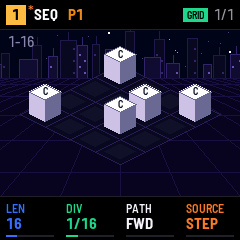
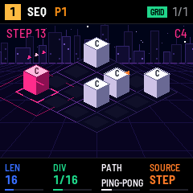
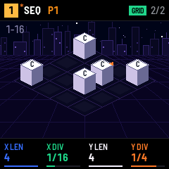
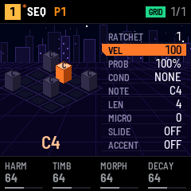
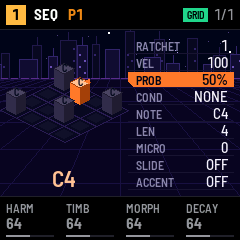
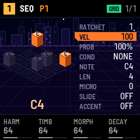
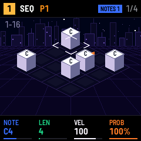
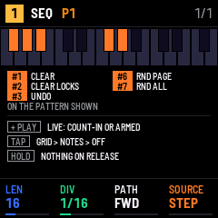
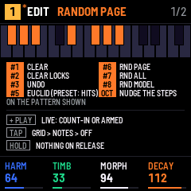

# Sequencer

[← Manual](index.html#s8) · [All pages](index.html#pages)

This page is about STEP patterns, the ones you write yourself. Press SEQ: the STEPS page shows the pattern's
current page of 16 steps as blocks on a 4 x 4 plateau, each with its note on top and as high as its velocity.

| Page | K1 | K2 | K3 | K4 |
| --- | --- | --- | --- | --- |
| STEPS | LEN, 1–64 steps | DIV, 1/32 to 1/1 | PATH | SOURCE |
| XY (PATH XY only) | X LEN, 1–4 | X DIV | Y LEN, 1–4 | Y DIV |

- **LEN** is the pattern's length, **DIV** the length of a step. The DIVs are 1/32, 1/16T, 1/16, 1/8T, 1/8, 1/4T,
  1/4, 1/2 and 1/1; T is a triplet.
- **SOURCE** changes where the pattern's notes come from ([Sources](index.html#s9)). Each pattern keeps its own steps whatever its
  source.
- **PATH** is the order the steps play in. A path draws itself on the plateau as arrows. With a LEN under 16, a
  path takes its first LEN places: SNAKE, COLUMNS and SPIRAL can reach a step beyond LEN, and the plateau lights the
  steps the path plays.

| PATH | Order |
| --- | --- |
| FWD | 1 to LEN. |
| REV | LEN back to 1. |
| PING-PONG | Forwards then backwards, without repeating the ends. |
| SNAKE | Each page's rows of four, every other row backwards. |
| COLUMNS | Each page's 4 x 4 grid, column by column. |
| SPIRAL | Each page's 4 x 4 grid, in a spiral from the corner to the centre. |
| RANDOM | A random step each time. |
| XY | Two clocks on the 4 x 4 grid: X walks along a row at X DIV, over X LEN steps; Y moves to the next row at Y DIV, over Y LEN rows. |

**Inspired by** [René](https://www.makenoisemusic.com/modules/rene) by Make Noise: a 4 x 4 grid of notes walked by
two clocks, one along X and one along Y.

## Playing, writing, recording

Without REC, the keys play the track, in SEQ too: you can look for an idea while the pattern plays. REC makes them
write, in one of three ways. Short presses on REC go round:

| Where | Short presses on REC |
| --- | --- |
| SEQ, a STEP pattern | off, GRID, NOTES, off |
| Other domains | off, NOTES (LIVE while playing), off |

- **GRID**: the 16 white keys are the 16 steps of the page.
- **NOTES**: a cursor walks through the pattern; the keys write the notes of the step under it.
- **LIVE**: what you play is recorded where it falls, while the pattern plays. Hold REC and press PLAY.

PLAY starts and stops. In GRID and NOTES there is no count-in, and stopping keeps the mode; stopping ends LIVE.

The keys play at a fixed velocity of 100; set a step's velocity afterwards. The last note or chord you played without
REC (keys held together) goes to the *clipboard*, ready to paste on a step. The clipboard is shared by the four
tracks; at the start it holds C4, and on a kit a pasted note becomes pad 1.

## GRID

In SEQ, press REC once. The white keys are the steps of the page shown; OCT- and OCT+ turn the page (1–16, 17–32…).
It works stopped or playing. A short press is a press released with nothing turned meanwhile.

- A short press on an empty step pastes the clipboard on it.
- A short press on a lit step cuts it: its content goes to the clipboard and the step is emptied.
- To move a step, cut it, then press where it goes. To copy it, cut it, then paste it back and on every other step.

The clipboard holds a whole step: notes, velocity, length, functions and p-locks.

## A held step

| While a step is held | Effect |
| --- | --- |
| nothing (stopped) | The step sounds. |
| white keys | Write its notes, a chord up to POLY (the natural notes; for sharps, use NOTES). On a kit, they add or remove pads, four at most. |
| black keys | Pick a function (below); 6 and 7 switch SLIDE and ACCENT. |
| PRESET | Sets the function picked (VEL first). |
| OCT+ / OCT- | Its length: one step more or less, up to 8 steps. A step written by hand lasts half a step, so the first notch ties it to the next one. |
| K1–K4 | P-locks of the page shown (below). |
| SELECT | Turns the p-lock pages. |

The plateau lifts the held step and shows its functions beside it. A long note draws a green band on the floor
towards the steps it covers, filled in pink while it sounds.

## Step functions

Each black key carries a family of functions: a press picks its first function, another press the next one. PRESET
sets it. Black keys 6 and 7 are different: they switch SLIDE and ACCENT on or off at once, and PRESET goes on setting
the function picked before.

| Black key | Function | Values |
| --- | --- | --- |
| 1 | RATCHET | 1–4: the step's notes repeated within the step. |
| 2 | VEL | 1–127. |
| 3 | PROB, then COND | PROB: 0–100 %, by 5 %. COND: below. |
| 4 | NOTE | The step's note, the whole chord moving with it. |
| 5 | LEN, then MICRO | LEN: in eighths of a step, up to 8 steps. MICRO: −11 to +11, in 24ths of a step, early or late. |
| 6 | SLIDE | On or off: the note is tied to the next step's, which plays without a new attack (and glides to it with GLIDE). |
| 7 | ACCENT | On or off: the velocity goes up by 32 and the envelope moves the filter 1.5 times as far. |
| 8–11 | — | Kept for later. |

COND decides on which loops the step plays, before PROB:

| COND | The step plays… |
| --- | --- |
| NONE | Always (then PROB decides). |
| FIRST | On the first loop only, after PLAY or a pattern change. |
| !FIRST | On every loop but the first. |
| PRE | If the last step with a condition or a PROB on this track played. |
| !PRE | If it did not. |
| A:B | On loop A of every B: 1:2 every other loop from the first, 2:4 the second loop of four… B goes from 2 to 8. |

For example: hold a step, press black key 3 for PROB, press it again for COND, turn PRESET to 1:2.

## P-locks

While a step is held, K1–K4 lock the knobs of a sound page to that step only: the step plays with its own value, the
others with the page's. SELECT turns the pages: ENGINE, SOUND, ADSR, FILTER, LFO, INSERT, MIX, ARP (a kit: ADSR,
FILTER, LFO, INSERT, MIX). A pattern holds up to 128 p-locks; past that, the header says `LOCKS FULL`.

## Several steps at once

Hold SEL and press steps: each press adds the step to the selection or takes it out, without switching it on or
off. The first one is the reference, whose functions are shown. Still holding SEL:

- a black key and PRESET: every step takes the reference's value, as you turn it (all at PROB 50 %, say);
- black key 6 or 7: SLIDE or ACCENT switches on the reference, and every step takes its new value;
- K1–K4: the same p-lock on every step;
- OCT+ / OCT-: each step one step longer or shorter.

Letting go of SEL clears the selection.

## NOTES

In SEQ, press REC twice (once in other domains). Every key is a note, black keys included, and the header shows
`NOTES` with the cursor's step. The keys light the notes already on that step.

- **Move the cursor** with PRESET, across the whole pattern; the plateau turns its page by itself. Hold SEL and press
  white key *n* to jump to step *n* of the page.
- **Play a note or a chord** to write it. On an empty step, the step is made (velocity 100, half a step long). On a lit
  step, only the notes change: velocity, length, functions and p-locks stay.
- The cursor moves on by the step's length when you let go of the last key. To fix a mistake, PRESET one notch back
  and play again.
- **A long note**: hold the key and turn PRESET, one step a notch.
- **A rest**: turn PRESET one notch without a key.
- **Set the step under the cursor** with K1–K4 directly, on three pages before STEPS (SELECT turns them). Turning a
  knob on an empty step makes it.
- Its p-locks: hold SEL and turn K1–K4; SEL and SELECT for the p-lock page.

| NOTES page | K1 | K2 | K3 | K4 |
| --- | --- | --- | --- | --- |
| 1 | NOTE, the whole chord | LEN | VEL | PROB |
| 2 | RATCHET | COND | MICRO | — |
| 3 | SLIDE | ACCENT | — | — |

SLIDE and ACCENT: right is on, left is off. In SEQ, NOTES works while playing too, and stopping keeps it. Out of SEQ,
it works stopped; PLAY then switches to LIVE (with the count-in if CLICK has one). While NOTES is on, PRESET moves
the cursor and changes neither the pattern, the model nor the insert.

## LIVE

- **Playing**: hold REC and press PLAY; the pattern keeps playing. Out of SEQ, arming REC while playing is enough.
- **Stopped, with a count-in** (GLO SCALE, CLICK at COUNT or BOTH): hold REC and press PLAY. A bar of count-in, then
  the recording.
- **Stopped, without**: hold REC and press PLAY to arm (`ARM`). The first note starts the pattern on step 1.

Notes are recorded with GLO's QUANT (OFF, 50 %, 100 %: how far they are pulled to the step), the knobs you turn
become p-locks, and the punch-ins you hold are written on the steps they cross.

To erase while playing:

- hold REC and press keys: they don't sound, and their notes are taken off the steps the pattern crosses;
- hold REC and OCT-: every step crossed is cleared.

REC (short) disarms and the pattern keeps playing. PLAY stops and disarms.

## REC held

| REC held + | Not in LIVE or ARM | In LIVE |
| --- | --- | --- |
| PLAY | LIVE, with the count-in or armed | — |
| black key 1 | CLEAR: empties the pattern shown | — |
| black key 2 | CLEAR LOCKS: removes its p-locks | — |
| keys | — | erase their notes as the pattern crosses them |
| OCT- | — | clears every step crossed |

A CLEAR cannot be undone.

## Random

Hold REC and press a black key of the second group of three to draw values at random, on any page:

| REC held + | Draws |
| --- | --- |
| black key 6 (RND PAGE) | the knobs of the page shown; on CHORD, STEP (LATTICE) and MOON, the item under PRESET's cursor too; on a STEP pattern, the 16 steps of the grid's page shown (OCT- / OCT+), nothing else |
| black key 7 (RND ALL) | the knobs of every page of the domain shown; in SEQ, the source's content too (below) |
| black key 8 (RND MODEL) | another model, on EDIT only (a synth may become a KIT, and back) |

Each knob is drawn anywhere in its range; a knob that picks (a preset, a chord, an arpeggio) lands on a whole choice.
The header shows `RANDOM PAGE`, `RANDOM ALL` or `RANDOM MODEL`. To try another model with new settings: black key 8,
then black key 7.

Never drawn, so that a draw never silences the track nor changes what it is:

| Knob | Why |
| --- | --- |
| SOURCE | it would change the source, and so the pages being drawn |
| MODEL | black key 8 draws it |
| SOUND's POLY | the number of voices |
| MIX's and KIT's LEVEL | the track could go silent or clip |
| TEMPO | the whole project's speed |
| STEPS' LEN and PATH, the XY page | LEN comes with black key 7's new pattern; an XY path could hold the pattern on one step |
| HOME (TRACKS, SONG) | the mix and the arrangement, not the sound |

In SEQ, black key 7 also draws the source's content:

- STEP: a new pattern, DIV drawn and LEN 16, 32, 48 or 64 (whole pages of the grid); PATH and the XY page are kept.
  The steps and their p-locks are cleared, then each step is lit at a density drawn between 25 and 75 %, as a step
  made by hand, with a note of the project's scale between C3 and C5 (a KIT: one of the 16 pads) and a velocity from
  60 to 127. Black key 6 does the same on the grid's page shown only: keep the pages you like, draw the others again.
- CADENCE: the 8 chords. LATTICE: the 8 steps. MOONS: every moon. LOOM: every cell of every lane.

The other sources have only their knobs. The keys do nothing (unlit on the map) in LIVE, where REC held erases notes;
with a step, a selection or a cell held, where the knobs set those; on HOME. A draw cannot be undone.

## Recipes

| I want to… | I do… |
| --- | --- |
| put a kick on the four beats | Play the kick pad without REC, then SEQ, REC (GRID), and press steps 1, 5, 9, 13. |
| enter a melody note by note | SEQ, REC twice (NOTES), play; PRESET for a rest, a key held + PRESET for a long note. |
| write a chord with sharps | NOTES, cursor on the step, play the chord. |
| change a step's notes, keep its settings | NOTES, cursor on the step, play the new notes. |
| move a step | GRID: press it (cut), then press where it goes. |
| hold a note three steps | GRID: hold the step, OCT+ twice. |
| push a note late by 1/24 | Hold the step, black key 5 twice (MICRO), PRESET. |
| set four steps to 50 % | GRID, hold SEL, press the four steps, black key 3 (PROB), PRESET. |
| record as I play, no count-in | Stopped: hold REC, press PLAY, then play: the pattern starts with the first note. |
| remove a wrong hi-hat while playing | In LIVE, hold REC and the hi-hat's key while the pattern passes it. |
| empty the pattern | Hold REC, press black key 1. |
| find a shortcut | Hold the button: its map shows. |

**Inspired by** Elektron's sequencers ([Digitakt manual](https://www.elektron.se/support-downloads/digitakt)):
the 16 keys as the steps, parameter locks, trig conditions (A:B, 1ST, PRE and their negations) and micro timing.
QUARTZ's COND has no FILL or NEI, and its PROB is a function of its own beside COND. The gestures around the
clipboard (paste the last note, cut to move, hold to hear) and SEL as a shift come from the
[OP-Z](https://teenage.engineering/guides/op-z).
