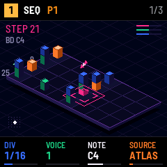
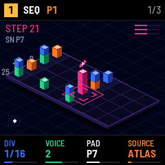

# ATLAS

[← Manual](index.html#s9)

ATLAS plays drums from a map of 25 drum rhythms of 32 steps, each with three parts: bass drum, snare and hi-hat. You
don't write the beat: you move around the map with X and Y, between the rhythms, and thin each part out or fill it in
with its density. It is the quickest way to a groove that keeps moving, on a KIT or on a single drum.

## Pages and knobs

| Page | K1 | K2 | K3 | K4 |
| --- | --- | --- | --- | --- |
| ATLAS | DIV | VOICE, 1–3 | NOTE (a kit: PAD) | SOURCE |
| MAP | X, 0–127 | Y, 0–127 | CHAOS, 0–127 | — |
| DENS | DENS 1 | DENS 2 | DENS 3 | — |

The numbers below were counted in the simulator on a KIT, at 120 BPM with DIV 1/16, over two loops.

| Knob | At 0 | Middle | At 127 |
| --- | --- | --- | --- |
| DENS 1–3, each part's density | The part is silent | The rhythm as drawn on the map: with all three at 64, about 4 hits a second | Every step the part can fill: about 11 hits a second with all three |
| X, Y, the place on the map | Both at 0: one corner's rhythm | Between four rhythms, blended | Both at 127: the opposite corner's rhythm |
| CHAOS | The pattern repeats exactly | — | The densities shaken at each loop: about 50 % more hits, rolls and ghost notes come and go |

- On a synth track, only the part VOICE plays, at the note NOTE.
- Accented hits play at full velocity.

## The scene

The 32 steps lie on a plateau; each part's hits are piled as blocks in its colour, the step playing in pink. X, Y and
the densities rebuild the piles as you turn them; CHAOS shakes them.

## On a kit

The three parts play, each on its own pad: VOICE picks a part and PAD the pad it plays (BD, SN, HH, P4 to P16; pads 1,
2 and 3 in a new pattern). Two parts on the same pad play it once.

## PRESET

PRESET steps through the 25 rhythms of the map, setting X and Y on them: the fastest way to audition the map, before
fine-tuning between two rhythms with X and Y.

## Recipes

| Effect | Settings |
| --- | --- |
| A kick alone | DENS 2 and DENS 3 at 0: only the bass drum part, about a hit every two beats at the map's centre |
| A busy, living groove | DENS 1–3 at 100, CHAOS 60: about 9 hits a second, never quite the same loop |
| Shaker instead of hats | On a kit, VOICE 3, PAD P15 (the shaker in a new kit) |
| A slow half-time beat | DIV 1/8: the same map, twice as slow |

**Inspired by** [Grids](https://pichenettes.github.io/mutable-instruments-documentation/modules/grids/manual/) by
Mutable Instruments: QUARTZ runs Grids' drum map and its pattern generator. Grids' Euclidean mode and its own clock
are not there.

---

[FLEET →](source-fleet.html)
