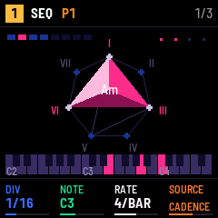

# CADENCE

[← Manual](index.html#s9) · [All pages](index.html#pages)

CADENCE plays a chord progression: 1 to 8 chords, one a bar (16 steps), in degrees of the project's scale. Major,
minor or diminished come from the scale, so every chord fits. A new pattern plays I – vi – IV – V. It is the backbone
for a pad or a stab part, and a source of chords for other tracks to follow.

## Pages and knobs

| Page | K1 | K2 | K3 | K4 |
| --- | --- | --- | --- | --- |
| CADENCE | DIV | NOTE | RATE: 1/BAR to 16/BAR | SOURCE |
| PROG | LEN, 1–8 | STRUM, 0–7 | VOICE: ROOT, SMOOTH | — |
| CHORD | DEGREE: I–VII | SIZE: TRIAD, SEVENTH, SUS2, SUS4 | — | — |

- RATE is how many times the chord is struck in a bar; each strike lasts until the next, and the first of the bar is
  accented.
- The chord plays as many notes as POLY: the root, the third, the seventh, then the fifth.

The numbers below were counted in the simulator on a new pattern, POLY 3, at 120 BPM with DIV 1/16.

| Knob | At its start | Middle | At its end |
| --- | --- | --- | --- |
| RATE | 1/BAR: one chord held through the bar (1.5 notes a second) | 4/BAR: a chord a beat (6 notes a second) | 16/BAR: a chord every step (about 24 notes a second) |
| LEN | 1: one chord, a drone | — | 8: eight chords, eight bars |
| STRUM | 0: the notes together | 1–4: 1/24, 1/12, 1/8, 1/6 of a step between notes, from the lowest up | 7: half a step between notes (5: 1/4, 6: 3/8) |
| VOICE | ROOT: each chord in root position on NOTE, jumps between chords | — | SMOOTH: the inversion closest to the chord before, never far from the root position: a smooth line |

## The scene

The seven degrees on a heptagon, the chord playing as a pink polygon joining its notes, the keys struck below.

## GRID

In SEQ, press REC once. White keys 1–8 are the chords: a short press gives the next size; hold one and press a note
of the scale to give it that degree, or turn K1 (degree) and K2 (size).

## On a kit

CADENCE plays nothing on a kit.

## PRESET

PRESET moves a cursor along the chords; the CHORD page sets the one under it, and the scene shows it.

## Recipes

| Effect | Settings |
| --- | --- |
| Held pad chords | RATE 1/BAR, VOICE SMOOTH, POLY 4, a slow ENV, on ENSEMBLE or HEX C |
| A stab on every beat | RATE 4/BAR, ENV with SUSTAIN 0 and a short DECAY |
| A harp-like strum | RATE 2/BAR, STRUM 5, on WIRE or CHLADNI |
| A darker progression | DEGREE VI, IV, I, V: the same chords, starting on the minor one |

CADENCE is QUARTZ's own.

---

[← LOOM](source-loom.html) · [LATTICE →](source-lattice.html)
