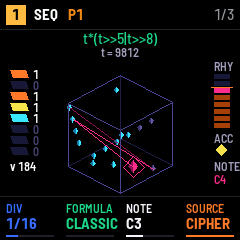
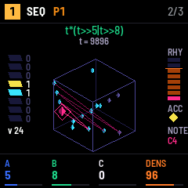
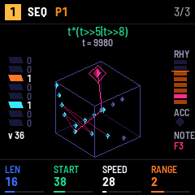
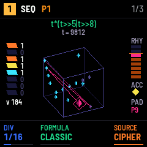

# CIPHER

[← Manual](index.html#s9)

CIPHER plays bytebeat: music from one line of arithmetic on time. At each step a formula turns a time `t` into a
byte, 0 to 255, and the byte decides everything about the step: whether it plays, its note (or its pad on a kit) and
its accent. The lines and beats it makes are mechanical and strange, with symmetries that come back over long
stretches. Pick a formula with PRESET, then move along its time with START and SPEED.

## Pages and knobs

| Page | K1 | K2 | K3 | K4 |
| --- | --- | --- | --- | --- |
| CIPHER | DIV | FORMULA, by name | NOTE (a kit: none) | SOURCE |
| PARAM | A, 0–15 | B, 0–15 | C, 0–15 | DENS, 0–127 |
| TIME | LEN: FREE, 1–64 | START, 0–127 | SPEED, 1–255 | RANGE, 1–4 octaves |

At each step `n` of the loop, `t = START × 256 + n × SPEED`, and the formula of `t` gives the byte `v`. Its bits each
have a job:

| Bits | Job |
| --- | --- |
| 5–7, the top three | The rhythm: the step plays when they are below DENS's level. |
| 4 | The accent: the step plays at full velocity. |
| 0–3, the bottom four | The note: a degree of GLO's scale, up to RANGE octaves above NOTE. On a kit, the pad, 1–16. |

The numbers below were counted in the simulator at 120 BPM with DIV 1/16 (8 steps a second), on CLASSIC.

| Knob | At its start | Middle | At its end |
| --- | --- | --- | --- |
| DENS | 0: silence | 64: about 4.5 notes a second | 127: a note on every step |
| A, B, C | The formula's numbers: each changes the pattern its own way (often a shift: `t>>A`) | — | — |
| LEN | FREE: the loop never comes back, `t` runs on | 16: a bar that repeats | 64: four bars |
| START | 0: the formula from `t` = 0 | — | 127: from `t` = 32 512, another stretch of it |
| SPEED | 1: `t` creeps, neighbouring steps are close | — | 255: big jumps of `t`, steps far apart |
| RANGE | 1: the notes within an octave | — | 4: over four octaves |

- Within the same formula, START and SPEED change the pattern as much as A, B and C: most formulas have stretches
  where they go flat, or only climb.

## The scene

Each step of the loop is a point whose coordinates are three bytes in a row, `v[n]`, `v[n+1]` and `v[n+2]`, in a wire
cube that sways. A regular formula draws a neat lattice, a chaotic one a cloud: the formula's structure, seen. Cyan
points play, violet ones are silenced by DENS; the step playing is framed, pink when it plays, with a trail of the
last six. On top, the formula with its values and `t`. On the left, the step's byte as its 8 bits, in the colour of
their job; on the right, what it plays: RHY, its rhythm level against DENS's line, ACC, and the note.

## On a kit

The bottom four bits pick the pad, so one formula makes a whole beat; NOTE is gone and the scene shows the pad.

## PRESET

PRESET steps through the 32 formulas, on any of the three pages. Each comes with its own A, B, C, START and SPEED,
chosen so that it plays a living pattern; DENS, LEN, NOTE and RANGE stay as they are. When a setting of your own goes
flat or silent, PRESET once forward and once back brings the formula's back.

## Recipes

| Effect | Settings |
| --- | --- |
| A busy riff on every step | MELODY (PRESET 7 times from CLASSIC): a note on every step, already at DENS 96 |
| A sparse line | WEAVE, DENS 40: about 3.5 notes a second |
| A beat from one formula | On a kit, CHIME: pads and accents from the same byte, about 4.5 hits a second |
| A line that never repeats | Any formula, LEN FREE |

## The formulas

`A`, `B` and `C` are the PARAM page's values; the formulas follow C's precedence (`*` and `%`, then `+` and `-`, then
the shifts, then `&`, `^`, `|`).

| Family | Name | Formula |
| --- | --- | --- |
| Pulse | CLASSIC | `t*(t>>A\|t>>B)` |
| Pulse | SIERPIN | `t&t>>A` |
| Pulse | FORTY2 | `t*((A*4+2)&t>>B)` |
| Pulse | LACE | `(t&t>>A)\|t>>B` |
| Pulse | KNOT | `t*(t>>A&t>>B)` |
| Pulse | GEAR | `t*A&t>>B` |
| Pulse | BEACON | `t*A\|t>>B` |
| Pulse | MELODY | `t*(0xCA98>>(t>>A&14)&15)\|t>>B` |
| Drift | DRIFT | `(t*A&t>>B)\|(t*3&t>>C)` |
| Drift | TIDE | `t*((t>>A\|t>>B)&63&t>>C)` |
| Drift | MOTOR | `(t>>A\|t\|t>>(t>>B))*C+(t>>11&7)` |
| Drift | STORM | `t*(t^t+(t>>A\|1)^(t-1280^t)>>B)` |
| Drift | MESH | `t*A&t>>B\|t>>C` |
| Drift | DIG | `(t&t>>A)-(t>>B)` |
| Drift | FLIP | `t>>A^t<<(B&7)` |
| Drift | SWELL | `(t*(t>>A&(B*4+3)))>>(t>>C&3)` |
| Stairs | STAIRS 1 | `t*((t>>A\|t>>B)&25&t>>C)` |
| Stairs | STAIRS 2 | `(t&t>>A)*(t>>B\|t>>C)` |
| Stairs | LADDER | `t*(t>>A&t>>B&123&t>>C)` |
| Stairs | TERRACE | `t*((t>>A\|t>>B)&82&t>>C)` |
| Stairs | WEAVE | `(t>>A)*(t>>B)` |
| Stairs | CHIME | `t*9&t>>A\|t*5&t>>B\|t*3&t>>C` |
| Stairs | SPIRAL | `t*(t>>A&15)>>(t>>B&3)` |
| Stairs | COIL | `t*(t>>A)&t>>B` |
| Chaos | CHAOS | `t\|t%(A*17+1)\|t%(B*17+2)` |
| Chaos | SPARK | `t*(t>>A)^t>>B` |
| Chaos | FLINT | `(t^t>>A)*(t>>B)` |
| Chaos | QUAD | `(t*t>>A)&t>>B` |
| Chaos | MODULO | `t*(t>>A)%(B*16+1)` |
| Chaos | XOR | `t>>A^t*B` |
| Chaos | FRACTAL | `(t*(t>>A)\|t>>B)^t>>C` |
| Chaos | GLITCH | `t*(t>>A^t>>B)&(C*16+15)` |

**Inspired by** viznut's [Algorithmic symphonies from one line of code](http://countercomplex.blogspot.com/2011/10/algorithmic-symphonies-from-one-line-of.html)
(2011), where bytebeat began, and by the Viznutcracker, sweet! app of
[Ornament & Crime](https://ornament-and-cri.me/user-manual-v1_3/), which steps its byte beats as a sequencer. Most
formulas here come from the collections that followed viznut's post, given numbers to turn.

---

[← IMPROV](source-improv.html)
