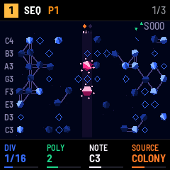

# COLONY

[← Manual](index.html#s9)

COLONY is a grid of 16 × 8 cells living by the Game of Life, read as music. A head reads one column a step, from left
to right; the living cells of the column play, from the bottom up. Every few loops, the grid moves on by a generation:
the pattern changes slowly by itself, by rules rather than by chance. Good for arpeggios and drum parts that evolve.

## Pages and knobs

| Page | K1 | K2 | K3 | K4 |
| --- | --- | --- | --- | --- |
| COLONY | DIV | POLY, 1–4 | NOTE (a kit: MAP) | SOURCE |
| SEED | SEED, 0–127 | DENS, 0–127 | AUTO, OFF ON | — |
| EVOL | GEN, 1 2 4 8 | MUT, 0–127 | — | — |

- A row is a degree of the scale above NOTE. POLY is how many cells of a column play, at most (three on a kit).
- **SEED** and DENS make the grid you start from: the same pair always gives the same grid. Turning either sows a new
  grid at the next loop. STOP then PLAY starts again from it.
- **GEN** is how many loops between two generations; **MUT** adds random cells at each one.
- A grid that dies or freezes, with MUT at 0: AUTO ON sows a new one; OFF leaves it. With DENS at 0 the grid stays
  empty, AUTO or not.
- Cells born at the last generation play accented.

The numbers below were counted in the simulator at 120 BPM with DIV 1/16 (8 steps a second), on a synth track, over
four loops.

| Knob | At its start | Middle | At its end |
| --- | --- | --- | --- |
| POLY | 1: one note a step at most, about 8 a second | 2: about 13 a second | 4: chords, about 18 notes a second |
| DENS | 0: an empty grid, silence | 64–70: a lively colony, the most notes | 127: a crowded grid that thins out fast (cells die of overcrowding): fewer notes than at 70 |
| GEN | 1: a new generation every loop, a fast change | — | 8: every eight loops, a slow change |
| MUT | 0: the rules alone; the colony may die or freeze | — | 127: random cells at each generation: it never settles |
| SEED | Each value its own starting grid | — | — |

## The scene

The living cells are atoms bonded to their neighbours; the rows are named by their note, and the head reading the
column is lit. You see the colony grow, crowd and die.

## On a kit

NOTE becomes MAP: MAP PADS plays pad 1–8 by row, and MAP BANDS plays pads 1, 2 and 3 for the bottom, middle and top
rows: the bass drum low, the snare in the middle, the hats on top. A row takes the colour of its pad's engine: BD
orange, SN green, HH white. Up to three cells of a column play.

## PRESET

PRESET turns SEED: a new grid at the next loop. Turn it until a colony you like comes up.

## Recipes

| Effect | Settings |
| --- | --- |
| An arpeggio that evolves | POLY 1, DIV 1/16, GEN 2, MUT 0 |
| Slowly moving chords | POLY 4, DIV 1/8, GEN 8 |
| Never the same drums | On a kit, MAP BANDS, MUT 40, AUTO ON |
| A sparse colony | DENS 30: about 8 notes a second instead of 13 |

**Inspired by** [Conway's Game of Life](https://en.wikipedia.org/wiki/Conway%27s_Game_of_Life) (John Horton Conway,
1970): a cell is born with three living neighbours and lives on with two or three.
