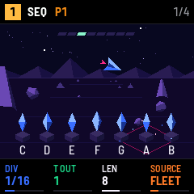
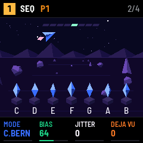
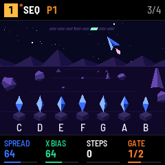
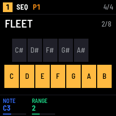

# FLEET

[← Manual](index.html#s9) · [All pages](index.html#pages)

FLEET draws random rhythms and random notes, and DEJA VU turns the draws into loops: from pure chance to a riff that
repeats, with everything in between. The T section decides when notes play, the X section which notes. It is the
source for melodies and bass lines you didn't have to write, and for keeping a part alive without changing it.

## Pages and knobs

| Page | K1 | K2 | K3 | K4 |
| --- | --- | --- | --- | --- |
| FLEET | DIV | T OUT, 1–3 | LEN, 1–16 | SOURCE |
| T | MODE | BIAS | JITTER | DEJA VU |
| X | SPREAD | X BIAS | STEPS | GATE, 1/8 to 4 steps |
| NOTES | NOTE | RANGE, 1–4 octaves | — | — |

- **T**: each step, t2 plays and t1 and t3 are drawn by MODE: C.BERN (one or the other, a coin toss), CLUSTERS,
  DRUMS (patterns like a kick and a snare), I.BERN (each its own coin), DIVIDER, 3 STATES, MARKOV. BIAS leans towards
  t1 or t3; JITTER shifts the notes in time, up to almost half a step.
- **X**: each note is drawn between NOTE and RANGE octaves above it. SPREAD sets how widely, X BIAS leans low or
  high, and STEPS keeps only the strongest notes of the scale as it goes up (the tonic, then the fifth, the third…).
- **GATE** is how long each note lasts, in steps (1/2 by default). Past one step, the notes overlap: they ring
  together up to POLY; with POLY 1, each note cuts the one before. A ratcheted note stays within one step. In the
  scene, the crystal a note hits stays lit for as long as the note lasts.
- **NOTES** page: the keys switch the notes FLEET may play on and off, in any octave; the scene shows the 12 notes.
  By default they are the project's scale.
- GLO's KEYS at ALL makes the white keys play the allowed notes on FLEET tracks.

The numbers below were counted in the simulator at 120 BPM with DIV 1/16 (8 steps a second), on a synth track with
T OUT 1 unless said otherwise.

| Knob | At its start | Middle | At its end |
| --- | --- | --- | --- |
| T OUT | 1: t1, a note on about half the steps | 2: t2, a note on every step | 3: t3, a note on about half the steps, those t1 skips |
| BIAS (C.BERN) | 0: t1 on every step, t3 never | 64: a fair coin, each about half the steps | 127: t3 on every step, t1 never |
| JITTER | 0: on the grid | Notes a little early or late | Up to almost half a step off: loose, human |
| DEJA VU | 0: every draw new | Middle: the draws repeat as a loop of LEN steps | 127: the loop in a shuffled order |
| SPREAD | Every note the same, at the X BIAS point | Notes spread around X BIAS | Only the two ends of the range: jumps |
| X BIAS | Notes lean to the bottom of the range | Centred | Notes lean to the top |
| STEPS | Every allowed note | Fewer: the strongest ones kept | Only the tonic |

## The scene

A squadron of ships over twelve crystals, one per note, C to B: each note fires at its crystal, which stays lit as
long as the note lasts.

## On a kit

t1, t2 and t3 play pads 1, 2 and 3: with the defaults, two hits on every step (16 a second), t2 on pad 2 and one of
pads 1 and 3. MODE DRUMS draws kick-and-snare-like patterns instead: about 10 hits a second. T OUT and the X section
do nothing on a kit.

## PRESET

PRESET draws new loops at once: with DEJA VU in the middle, turn it until a loop you like comes up, then leave it.

## Recipes

| Effect | Settings |
| --- | --- |
| A random riff that loops | DEJA VU 64, LEN 8: the draws repeat every 8 steps; PRESET for another riff |
| A bass line on the strong notes | NOTE C2, RANGE 1, X BIAS 30, STEPS 100 (in a seven-note scale: tonic, fifth and third) |
| Every step, a new note | T OUT 2: a note on every step, its pitch drawn each time |
| A drum machine that never repeats | On a kit, MODE DRUMS, DEJA VU 0 |

**Inspired by** [Marbles](https://pichenettes.github.io/mutable-instruments-documentation/modules/marbles/manual/)
by Mutable Instruments: QUARTZ runs Marbles' t models, its X draws and its DEJA VU, one step at a time. LEN is the
loop's length here, 1–16; the X outputs play one at a time, and Marbles' ramps and external clock are not there.

---

[← ATLAS](source-atlas.html) · [COLONY →](source-colony.html)
