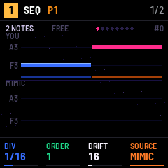
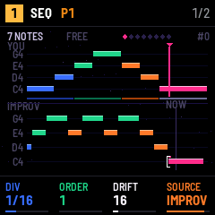

# IMPROV

[← Manual](index.html#s9)

You play a phrase, IMPROV improvises on it: it picks a place in the phrase where the last notes it played appear, and
goes on from there. The result sounds like your phrase, rearranged: a duet partner that only knows what you taught it.

## Pages and knobs

| Page | K1 | K2 | K3 | K4 |
| --- | --- | --- | --- | --- |
| IMPROV | DIV | ORDER, 1–2 | DRIFT, 0–127 | SOURCE |
| LOOP | LOOP: FREE, 1–16 | — | — | — |

- A new pattern has no phrase: IMPROV stays silent and the screen says `REC TO TEACH`.
- The white keys 1–8 show where in the phrase IMPROV is reading, in eighths; in LISTEN, how full the phrase is.

| Knob | At its start | Middle | At its end |
| --- | --- | --- | --- |
| ORDER | 1: matches the last note: free, surprising | — | 2: matches the last two: closer to your phrase |
| DRIFT | 0: always follows the phrase | Now and then a jump | 127: jumps anywhere in the phrase every time |
| LOOP | FREE: never repeats | 4: a short riff, the same every 4 steps | 16: a riff of a bar |

## LISTEN

In SEQ, press REC once. IMPROV goes quiet, the header shows `LISTEN`, and every note you play is learnt, with the time
until the next one (up to 7 steps; notes played together make a chord). The first note clears the old phrase; the
phrase keeps the last 32 notes. Press REC again to stop: the time since the last note becomes its gap. Changing
pattern, track, source or domain stops LISTEN too.

## The scene

Your phrase above (YOU) in four coloured quarters, the improvisation below (IMPROV) scrolling from the NOW line: the
colours show which part of your phrase it is drawing on.

## On a kit

Teach it pads: IMPROV plays the pads it learnt, rearranged, as a drummer would vary a fill.

## PRESET

PRESET draws again: another improvisation from the same phrase, at once.

## Recipes

| Effect | Settings |
| --- | --- |
| A variation on your riff | Teach 6–10 notes, ORDER 2, DRIFT 0 |
| A riff that repeats | LOOP 8 or 16; PRESET until one you like |
| Free improvisation | ORDER 1, DRIFT 60, LOOP FREE |

**Inspired by** the [Continuator](https://www.francoispachet.fr/?p=4360) by François Pachet (Sony CSL, 2003), which
learns a musician's phrases as they play and answers in their style. IMPROV learns one phrase, with ORDER 1 or 2.

---

[← MOONS](source-moons.html)
