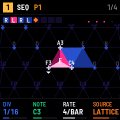

# LATTICE

[← Manual](index.html#s9) · [All pages](index.html#pages)

LATTICE plays a chord a bar that walks on the Tonnetz, the lattice of notes where neighbouring triads share two
notes. Each step of a sequence of up to 8 transforms the chord by P, L or R, and each keeps two of its three notes, so
the chords always flow, often outside the usual progressions. Good for film-like harmony and slowly morphing pads.

## Pages and knobs

| Page | K1 | K2 | K3 | K4 |
| --- | --- | --- | --- | --- |
| LATTICE | DIV | NOTE | RATE: 1/BAR to 16/BAR | SOURCE |
| WALK | LEN, 1–8 | CHAOS, 0–127 | SCALE: FREE, IN SCALE | RETURN: OFF, ON |
| PLAY | STRUM, 0–7 | VOICE: ROOT, SMOOTH | — | — |
| STEP | OP: –, P, L, R | — | — | — |

- **P** (parallel) swaps major and minor on the same root: C ↔ Cm. **L** (leading tone) moves the root by a
  semitone: C ↔ Em. **R** (relative): C ↔ Am. **–** keeps the chord.
- It starts on the triad of the scale on NOTE. A new pattern walks R L R L.
- RATE, STRUM and VOICE play the chord as in [CADENCE](source-cadence.html): with POLY 3 at 120 BPM, 1/BAR is about
  1.5 notes a second, 16/BAR about 24.

| Knob | At its start | Middle | At its end |
| --- | --- | --- | --- |
| LEN | 1: one transform, repeated | — | 8: eight steps before RETURN |
| CHAOS | 0: the walk as written | Some steps take another transform | 127: almost every step another transform: it wanders |
| SCALE | FREE: the walk may leave GLO's scale, chromatic chords | — | IN SCALE: every chord in the scale; a transform that would leave it is replaced by one that doesn't, or the chord stays |
| RETURN | OFF: walks on, never comes back | — | ON: back to the first chord after the sequence: a loop |

## The scene

The lattice of notes, the chord playing as a pink triangle that flips to its neighbour at each transform; the steps on
top.

## GRID

In SEQ, press REC once. White keys 1–8 are the steps: a short press gives the next one (–, P, L, R); hold one and
press black key 1–4 for P, L, R or –, or turn K1.

## On a kit

LATTICE plays nothing on a kit.

## PRESET

PRESET moves a cursor along the steps; the STEP page sets the one under it.

## Recipes

| Effect | Settings |
| --- | --- |
| A looping progression | RETURN ON, SCALE IN SCALE, LEN 4 |
| An endless, wandering harmony | RETURN OFF, SCALE FREE, CHAOS 40 |
| Soft morphing pad | RATE 1/BAR, VOICE SMOOTH, POLY 3, on ENSEMBLE |

**Inspired by** the [Tonnetz](https://en.wikipedia.org/wiki/Tonnetz) (Leonhard Euler, 1739) and the
[neo-Riemannian](https://en.wikipedia.org/wiki/Neo-Riemannian_theory) transformations P, L and R (David Lewin,
Richard Cohn).

---

[← CADENCE](source-cadence.html) · [MOONS →](source-moons.html)
