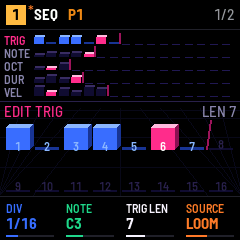
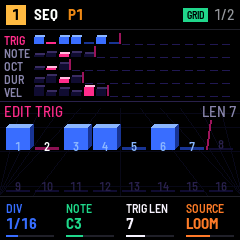

# LOOM

[← Manual](index.html#s9)

LOOM is a step sequencer pulled apart: five lanes, TRIG, NOTE, OCT, DUR and VEL, each a loop of 1 to 16 cells with
its own length. All the heads move one cell a step; with different lengths they drift apart, and the melody takes a
long time to come back. You write a few cells and get a line that keeps shifting against itself.

## Pages and knobs

| Page | K1 | K2 | K3 | K4 |
| --- | --- | --- | --- | --- |
| LOOM | DIV | NOTE | TRIG LEN, 1–16 | SOURCE |
| LENS | NOTE LEN | OCT LEN | DUR LEN | VEL LEN |

| Lane | Values | What a cell does |
| --- | --- | --- |
| TRIG | off, on | A note plays or not. |
| NOTE | 0–15 | Degrees of the scale above NOTE; on a kit, the pad 1–16. |
| OCT | 0–4 | −2 to +2 octaves (not on a kit). |
| DUR | 0–4 | ¼, ½, 1, 2 or 4 steps. |
| VEL | 0–3 | Velocity 40, 70, 100, or 100 accented. |

The numbers below were counted in the simulator on a new pattern at 120 BPM with DIV 1/16 (8 steps a second).

| Knob | At 1 | Middle | At 16 |
| --- | --- | --- | --- |
| TRIG LEN | The first TRIG cell alone, repeated: here a note on every step | A new pattern's 7: about 4.5 notes a second | All 16 cells: here about 2 notes a second |
| NOTE, OCT, DUR, VEL LEN | The lane holds one value: it stops moving | — | The whole lane: the longest cycle |

When the lengths have no common factor (5, 7, 8…), the whole line takes their product in steps to come back: lengths
5, 7 and 8 repeat only every 280 steps.

## The scene

The five lanes small on top, the lane you edit big below, each with its head: you see the heads drift apart.

## GRID

In SEQ, press REC once. The white keys are the edited lane's cells: a short press switches a TRIG on or off, or
raises another lane's value by one (back to 0 after the top). Hold a cell and turn K1 to set it; hold a NOTE cell and
press another key to write that note. Hold a cell 0.4 s for its help. The keys light the cells set, and the lane's
head.

## On a kit

A NOTE cell is a pad, 1–16, and the OCT lane is not used: LOOM becomes a drum sequencer whose pads, lengths and
velocities each loop on their own.

## PRESET

PRESET picks the lane you edit; the scene shows it big.

## Recipes

| Effect | Settings |
| --- | --- |
| A line that drifts | TRIG LEN 7, NOTE LEN 5, OCT LEN 3: three lengths with no common factor |
| A steady pulse, moving notes | TRIG LEN 1 on an on cell (a note every step), NOTE LEN 5 |
| Living hats on a kit | NOTE cells on the hat pads, VEL LEN 3 against TRIG LEN 8: the accents wander |

**Inspired by** [Kria](https://monome.org/docs/ansible/kria/) by monome (for Ansible and the grid): a step sequencer
whose trigger, note, octave and duration have loops of their own lengths. LOOM adds a velocity lane, and its lanes are
always independent.

---

[← COLONY](source-colony.html) · [CADENCE →](source-cadence.html)
