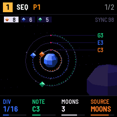

# MOONS

[← Manual](index.html#s9)

MOONS puts one to four moons on orbits around a planet. Each moon goes round in PERIOD steps and plays its note each
time it passes the top. Moons with different periods meet now and then: those meetings play accented. It makes
polyrhythms you can see: simple periods give a steady groove, odd ones a pattern that takes a long time to come
round.

## Pages and knobs

| Page | K1 | K2 | K3 | K4 |
| --- | --- | --- | --- | --- |
| MOONS | DIV | NOTE | MOONS, 1–4 | SOURCE |
| MOON | PERIOD, 1–32 | PHASE, 0–31 | NOTE, 16 degrees of the scale, shown as notes (a kit: PAD, BD SN HH P4–P16) | — |

- A moon's note is degrees of the scale above NOTE; on a kit, its pad.
- A new pattern has three moons, periods 8, 6 and 5, playing C, E and G: they meet again every 120 steps.
- The white keys 1–4 light as their moon passes.

The numbers below were counted in the simulator on a new pattern at 120 BPM with DIV 1/16 (8 steps a second).

| Knob | At its start | Middle | At its end |
| --- | --- | --- | --- |
| MOONS | 1: a note every 8 steps (1 a second) | 3: about 4 notes a second | 4: about 6.5 notes a second |
| PERIOD | 1: the moon plays every step | 16: once a bar | 32: once every two bars |
| PHASE | 0: on the orbit's start | — | Shifted along: two moons of the same period play one after the other |

The whole pattern comes back when every moon is back at its start: after the least common multiple of their periods
(8, 6 and 5: 120 steps; 4, 8 and 16: only 16).

## The scene

The moons on their orbits around a faceted planet, each named by its note; a moon flashes as it passes the top.

## On a kit

NOTE becomes PAD: each moon plays a pad. Periods 4 on a hat, 16 on a kick and 16 at PHASE 8 on a snare make a plain beat; periods
3, 5 and 7 a rolling polyrhythm.

## PRESET

PRESET picks the moon the MOON page sets; the scene frames it.

## Recipes

| Effect | Settings |
| --- | --- |
| A polyrhythm | Three moons, periods 3, 4 and 5 |
| A beat on a kit | Moons on BD (period 8), SN (period 16, PHASE 8) and HH (period 2) |
| An arpeggio | Three moons, period 4, PHASE 0, 1 and 2, NOTE C3, E3 and G3 (in a new pattern): the triad up, a step apart |

MOONS is QUARTZ's own. Orbit sequencers such as [Aphelian](https://apps.apple.com/app/aphelian/id1435855056) play
with the same image.

---

[← LATTICE](source-lattice.html) · [IMPROV →](source-improv.html)
