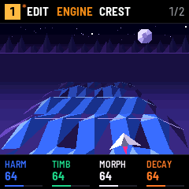

# Analog: CREST, SWEEP, KINK, PRISM

[← Manual](index.html#s6)

The analog family is the place to start for basses, leads and plucks: simple waveforms that HARM, TIMB and MORPH bend
in plain, predictable ways. None of the four makes its own envelope: ENV's ADSR shapes their level, and DECAY how long
a note rings after its gate closes.

The values below were measured on the note C3 with the two other knobs at 64. A change below 300 Hz is clear on
headphones and faint on the FM-1's speaker.

The scene flies over crests drawn with the model's own waveform: HARM, TIMB and MORPH reshape the crests as they
reshape the sound, and DECAY sets how long the ship's shot lasts. The ship fires at the next crest on each note.

## CREST

**Sound.** Two classic analog waveforms played together, a pulse and a saw. The plainest model of the four: a good
first choice for a bass or a lead.

| Knob | At 0 | Middle | At 127 |
| --- | --- | --- | --- |
| HARM, the second wave's pitch | Both waves on the same note: round, most of the energy on the note itself | The second wave apart: a fuller, wider sound | The second wave higher up: the body moves up an octave and more |
| TIMB, the pulse | A thin pulse: quieter, nasal | A square: full | Hard sync: a bright, cutting edge (most of the energy around 1.2–2.4 kHz) |
| MORPH, the saw | A triangle | A saw: the loudest setting | A saw with a wide notch: quieter |

**Start with** the defaults (64 everywhere), then turn TIMB: it changes the character more than the two others.

**Recipes**

| Sound | Settings |
| --- | --- |
| Bright bass | Low notes (C2), HARM 0, TIMB 0, MORPH 127 |
| Round bass | HARM 40, the rest at 64: the energy sits on the note itself |
| Cutting lead | Notes around C4, HARM 64, TIMB 100, MORPH 64 |

## SWEEP

**Sound.** Classic waves through a resonant filter, as on a subtractive synth: TIMB is the filter's cutoff. The
model for filter sweeps and resonant basses.

| Knob | At 0 | Middle | At 127 |
| --- | --- | --- | --- |
| HARM, resonance and slope | A sharp resonant peak at the cutoff | Smooth: no peak | A sharp, louder peak, with a steeper slope |
| TIMB, the cutoff | Closed: almost silent | Half open: the low half of the sound | Open: bright |
| MORPH, waveform and sub | One end of the waveform and sub mix | The middle of the mix | The other end: the level barely changes, the colour does |

**Start with** TIMB around 60 and turn it while a note plays: below 30 the sound turns dark and quiet fast.

**Recipes**

| Sound | Settings |
| --- | --- |
| Resonant bass | Low notes (C2), HARM 110, TIMB 45, MORPH 0: loud, its energy below 300 Hz |
| Dark pad | HARM 64, TIMB 30, POLY 3: soft and low |
| Open saw | HARM 64, TIMB 95: bright, for leads and stabs |

## KINK

**Sound.** Phase distortion, as on Casio's CZ synths: a sine bent into brighter shapes. Glassy leads and buzzy basses.

| Knob | At 0 | Middle | At 127 |
| --- | --- | --- | --- |
| HARM, the distortion's frequency | Low: a warm, rounded tone | Higher: a nasal formant | Highest: bright and thin |
| TIMB, the amount | None: close to a sine | Some: nasal | Full: bright and buzzy (most of the energy around 2.4–4.8 kHz) |
| MORPH, asymmetry | Symmetric | A little bent | Bent: the body moves down, hollower |

**Start with** TIMB at 30 for a clean tone, then raise it.

**Recipes**

| Sound | Settings |
| --- | --- |
| Deep bass | Low notes (C2), HARM 20, TIMB 30, MORPH 64: its energy below 150 Hz |
| Nasal lead | Notes around C4, HARM 64, TIMB 80, MORPH 30: bright and buzzy |

## PRISM

**Sound.** A triangle shaped, then folded back on itself: from a soft sine to a metallic growl. Fold sweeps are its
speciality.

| Knob | At 0 | Middle | At 127 |
| --- | --- | --- | --- |
| HARM, the waveshape | Most of the energy around 1 kHz | Much the same, fuller | Spread far up: brighter |
| TIMB, the fold | No fold: close to a sine, round | Folded: the body moves up | Folded again: louder, harmonics far up |
| MORPH, asymmetry | Symmetric | A little bent | Bent: a lower, darker body |

**Start with** TIMB at 0 for a pure tone, then fold it in.

**Recipes**

| Sound | Settings |
| --- | --- |
| Sine bass | Low notes, TIMB 0: a soft, pure tone |
| Fold growl | Low notes (C2), HARM 40, TIMB 110, MORPH 64 |
| Fold sweep | A note held, an LFO on TIMB (LFO page: DEPTH 40, DEST TIMB) |

**Inspired by** [Plaits](https://pichenettes.github.io/mutable-instruments-documentation/modules/plaits/manual/) by
Mutable Instruments, whose virtual analog, VA with VCF (firmware 1.2), phase distortion (1.2) and waveshaper models these are.

---

[FM →](synth-fm.html)
