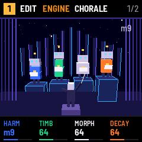
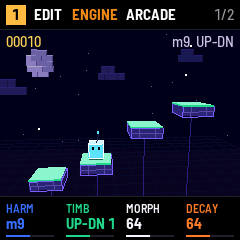

# Chords: CHORALE, ENSEMBLE, ARCADE

[← Manual](index.html#s6) · [All pages](index.html#pages)

The chords family plays a whole chord from a single note: one key, one voice, four notes. It frees the track's POLY
for other things and turns any pattern source into a chord progression. HARM picks the chord, the same eleven on the
three models, and the footer shows its name:

OCTAVE, FIFTH, SUS4, m, m7, m9, m11, 6/9, M9, M7, M (m minor, M major).

None of the three makes its own envelope: ENV's ADSR shapes their level. The values below were measured on the note
C3 with the two other knobs at 64. A change below 300 Hz is clear on headphones and faint on the FM-1's speaker.

CHORALE and ENSEMBLE share a choir of androids on a stage, one per voice, each on a step as high as its note: the
chord drawn as a staircase. ARCADE has its own scene, below.

## CHORALE

**Sound.** A four-note chord of simple waveforms: the plainest chord machine, for stabs and progressions.

| Knob | At 0 | Middle | At 127 |
| --- | --- | --- | --- |
| HARM, the chord | OCTAVE | m9 | M |
| TIMB, the inversion | The chord low: most of the energy below 150 Hz | Inverted up: 150–600 Hz | High up: above 600 Hz |
| MORPH, the waveform | Brighter, around 600 Hz–2.4 kHz | The fullest | Quieter, centred around 1 kHz |

**Start with** HARM on m7 or M7 and TIMB at 64: the chord sits in the middle of the range.

**Recipes**

| Sound | Settings |
| --- | --- |
| Minor stab | HARM m7, TIMB 64, ENV with SUSTAIN 0 and a short DECAY |
| Low drone | HARM FIFTH, TIMB 0, a long ENV RELEASE |
| Bright progression | HARM M9, TIMB 127, on LATTICE or CADENCE |

## ENSEMBLE

**Sound.** A string machine: the chord through a filter and a chorus, as on the strings ensembles of the 70s. Soft,
wide pads.

| Knob | At 0 | Middle | At 127 |
| --- | --- | --- | --- |
| HARM, the chord | OCTAVE | m9 | M |
| TIMB, chorus and filter | Filter closed: dark and very quiet | Open: brighter, the chorus in | Open: a bit more body |
| MORPH, the waveform | Lower, around 150–600 Hz | Brighter | The body around 150–300 Hz, louder |

**Start with** TIMB at 64 and MORPH at 127.

**Recipes**

| Sound | Settings |
| --- | --- |
| String pad | HARM m9, TIMB 64, MORPH 127, a slow ENV ATTACK and RELEASE |
| Filter swell | A chord held, an LFO on TIMB (DEPTH 40, DEST TIMB, a slow RATE) |

## ARCADE

**Sound.** Square-wave chords played as fast arpeggios, as on the sound chips of 8-bit consoles. HARM picks the
chord, TIMB the arpeggio: UP, DOWN, UP-DN or RAND, over 1, 2 or 4 octaves (UP 1 … RAND 4, twelve in all). The
footer shows both.

A cube robot hops from block to block, one block per note of the arpeggio: HARM sets the blocks, TIMB the order it
hops in and MORPH the blocks' width.

| Knob | At 0 | Middle | At 127 |
| --- | --- | --- | --- |
| HARM, the chord | OCTAVE | m9 | M |
| TIMB, the arpeggio | UP 1 | UP-DN 1 | RAND 4 |
| MORPH, pulse width and sync | A mix of low and very high: hollow and buzzy | A square, around 1.2–2.4 kHz | Sync: very bright, 4.8–9.6 kHz |

**Start with** HARM on M, TIMB on UP 1: the classic chip arpeggio.

**Recipes**

| Sound | Settings |
| --- | --- |
| Chip arpeggio | HARM M, TIMB UP 1, MORPH 64, one long note |
| Wide arpeggio | HARM m7, TIMB UP-DN 4 |
| Harsh chip | MORPH 127: bright, keep the level down |

**Inspired by** [Plaits](https://pichenettes.github.io/mutable-instruments-documentation/modules/plaits/manual/) by
Mutable Instruments, whose chords, string machine (firmware 1.2) and chiptune (1.2) models these are.

---

[← Spectral](synth-spectral.html) · [Voice →](synth-voice.html)
