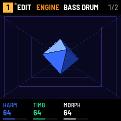
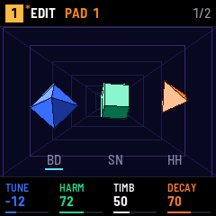
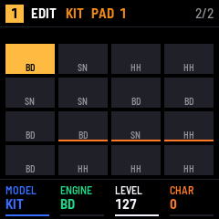

# Drums: BASS DRUM, SNARE, HI-HAT, KIT

[← Manual](index.html#s6) · [All pages](index.html#pages)

The drums family is Plaits' three analog-style drums, each playable as a model on its own, and KIT, which puts sixteen
of them on the keys as pads. The drums make their own envelope: ENV's ADSR then shapes only the filter, and MORPH (on a
kit, the pad's DECAY) sets how long a hit rings: a drum played on its own has no DECAY on ENGINE.

The values below were measured with the two other knobs at 64, the bass drum on C2 and the others on C3. A bass drum
lives below 150 Hz: it is clear on headphones and faint on the FM-1's speaker; raise its TUNE or its HARM to hear it
there.

A drum played on its own is a faceted shape in a neon tunnel (the snare a cube), struck on each hit: HARM, TIMB and
MORPH reshape it. On a kit's PAD page, the scene shows the three drums, the one the knobs set lit.

## BASS DRUM

**Sound.** An analog bass drum: from a deep, soft thump to a driven, punchy kick.

| Knob | At 0 | Middle | At 127 |
| --- | --- | --- | --- |
| HARM, attack and drive | Soft and quiet | Firm | Driven: much louder, a click on top |
| TIMB, the brightness | Pure sub | A little body | The same, a little brighter |
| MORPH, the decay | A short thump | — | A long boom |

**Start with** MORPH at 100 for a long kick, HARM at 90 to hear it on the speaker.

**Recipes**

| Sound | Settings |
| --- | --- |
| Long boom | HARM 90, MORPH 110: loud, nearly all below 150 Hz |
| Tight kick | HARM 100, MORPH 30: short, half as loud |

## SNARE

**Sound.** An analog snare: a tuned drum head and a noise of snares.

| Knob | At 0 | Middle | At 127 |
| --- | --- | --- | --- |
| HARM, tone to noise | The head's tone: 150–300 Hz | Both | The snares' noise: 1.2–9.6 kHz, louder |
| TIMB, the drum's modes | Bright | Body and noise | More body: energy moves down to 300–600 Hz |
| MORPH, the decay | Short and quiet | — | Long |

**Start with** HARM at 64: the head and the snares together.

**Recipes**

| Sound | Settings |
| --- | --- |
| Tight snare | HARM 64, MORPH 30: short, the head and a little noise |
| Noisy snare | HARM 127, MORPH 50: the snares alone, 1.2–9.6 kHz |

## HI-HAT

**Sound.** An analog hi-hat: metallic squares through a high-pass filter, mixed with noise.

| Knob | At 0 | Middle | At 127 |
| --- | --- | --- | --- |
| HARM, metal to noise | Metallic | Mixed | Noisier: more energy above 4.8 kHz |
| TIMB, the high-pass | Open: low and middle in, a clang | Around 600 Hz–2.4 kHz | Only the top: thin, above 4.8 kHz |
| MORPH, the decay | Closed hat: very short | — | Open hat: long |

**Start with** MORPH at 30 for a closed hat and 110 for an open one.

**Recipes**

| Sound | Settings |
| --- | --- |
| Closed hat | MORPH 30 |
| Open hat | TIMB 90, MORPH 110: long, most of it at 2.4–4.8 kHz |

## KIT

KIT turns the track into 16 drum pads on the white keys. Each pad is one of Plaits' three drums (BD, SN or HH) with
its own tuning and settings, and a kit plays up to three pads at once. With KIT, EDIT has two pages:

| Page | K1 | K2 | K3 | K4 |
| --- | --- | --- | --- | --- |
| PAD | TUNE, −24 to +24 | HARM, 0–127 | TIMB, 0–127 | DECAY, 0–127 |
| KIT | MODEL, by name | ENGINE, BD SN HH | LEVEL, 0–127 | CHAR, 0–127 |

The knobs set the last pad played, named in the header (`PAD 1`). In EDIT, hold a pad: K1–K4 set that pad and PRESET
changes its engine. KIT's scene is the 16 pads, each with its engine, the one the knobs set lit, and a bar under each
pad that shows its CHAR.

CHAR mixes the two sounds each drum engine makes: 0 the analog one, 127 a synthetic take on the same drum (on HH, a
ring-modulated noise instead of metallic squares), between them a blend.

| Pad | 1 | 2 | 3 | 4 | 5 | 6 | 7 | 8 |
| --- | --- | --- | --- | --- | --- | --- | --- | --- |
| Default | Bass drum | Snare | Closed hat | Open hat | Rim | Clap | Low tom | Mid tom |
| **Pad** | **9** | **10** | **11** | **12** | **13** | **14** | **15** | **16** |
| Default | High tom | Synth bass drum | Synth snare | Synth hat | Conga | Cowbell | Shaker | Ride |

**Recipes**

| Sound | Settings |
| --- | --- |
| Long sub kick | A BD pad, TUNE −5, HARM 30, TIMB 30, DECAY 115: almost all of it below 150 Hz, for headphones and big speakers |
| Punchy kick | A BD pad, TUNE 0, HARM 110, TIMB 80, DECAY 40: louder, with a click at 300–600 Hz the speaker plays |
| Synth snare | A SN pad, CHAR 127: more body at 150–300 Hz, less sizzle at 2.4–4.8 kHz |
| Bright hat | A HH pad, CHAR 127: most of its energy at 2.4–4.8 kHz |

**Inspired by** [Plaits](https://pichenettes.github.io/mutable-instruments-documentation/modules/plaits/manual/) by
Mutable Instruments, whose analog bass drum, snare and hi-hat models these are; CHAR mixes in the synthetic version
each one makes on Plaits' second output.

---

[← Physical](synth-physical.html)
