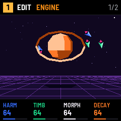

# FM: MOON, HEX A, HEX B, HEX C

[← Manual](index.html#s6)

FM makes its sounds by letting sine waves bend each other's pitch: bells, electric pianos, glassy keys, punchy basses
and brass. MOON is a simple two-operator FM synth built from scratch with the knobs; HEX A–C are six-operator FM with
96 ready-made sounds from the classic six-operator banks. HEX A–C make their own envelope: ENV's ADSR then shapes
only the filter, and DECAY sets the length of the preset's envelope.

The values below were measured on the note C3 with the two other knobs at 64. A change below 300 Hz is clear on
headphones and faint on the FM-1's speaker.

The scene is a cut planet with a ring: the ships in orbit fire at it on each note, and MORPH tilts the ring.

## MOON

**Sound.** Two sine operators, one bending the other. Low values are close to a plain sine; turned up, it rings like
a bell or buzzes like a reed.

| Knob | At 0 | Middle | At 127 |
| --- | --- | --- | --- |
| HARM, the ratio of the two operators | A low, hollow tone (150–600 Hz) | A clear tone around 1 kHz | Metallic, inharmonic: spread from 600 Hz to 4.8 kHz |
| TIMB, the modulation index | No modulation: a pure sine on the note | Some: the tone moves up | Full: bright and buzzy (most of the energy above 1.2 kHz) |
| MORPH, feedback | No feedback: clean | Some | Rough, noisier, spread over more bands |

**Start with** TIMB at 0, then raise it slowly: the sound goes from sine to bell to buzz.

**Recipes**

| Sound | Settings |
| --- | --- |
| Sine bass | Low notes, TIMB 0 |
| Bell | HARM 127, TIMB 64, MORPH 0, with a short ENV (SUSTAIN 0) |
| Reed lead | HARM 64, TIMB 100, MORPH 90 |

## HEX A, HEX B, HEX C

**Sound.** Six-operator FM with 32 presets each, picked by HARM: the footer shows the preset's name. HEX A holds
basses and synths, HEX B keys, plucks and percussion, HEX C organs, pads, strings and brass.

| Knob | At 0 | Middle | At 127 |
| --- | --- | --- | --- |
| HARM, the preset | The first of the 32 | — | The last |
| TIMB, the modulators' level | Softer, duller than the preset | The preset as designed | Brighter and harsher (on HEX A, more of the energy far up) |
| MORPH, envelope stretch | Short: everything decays fast | The preset as designed | Stretched: slow attacks, a held note can take a while to sound |

The presets of each bank:

| Bank | Presets |
| --- | --- |
| HEX A | SOLID BAS, DEEP LOW, LEADTAPE, ACID LINE, BASS 3, BILL BASS, BASS 1, ELEC BASS, S.BAS 27.7, RESONANT, SYNBASS 2, PRC SYN 1, PRISMA 2, ANALOG 4, ANALOG A, ANALOG 6, BIG POLY, INSERT 1, SPIRAL, TROTTER, GASHAUS, RING DING, PAPAGAYO, WINE GLAS, AMYTAL, VINTAGE 1, WAVE V1, WAVE V2, VINTAGE 3, VOCODER 2, SEQUENCE, BOUNCE 4 |
| HEX B | E.PIANO 1, TINES 1, WINTER EP, RS-EP C, EP DELUXE, CLAV EP, SYN-CLAV, CLAV, PIANO 5, GRAND 1, CONCERT, AC GUITAR, SITAR, KOTO, HARPSI 1, CLAV 3, XYLO, MARIMBA, VIBE 1, GLOCKEN, BELL C, BELLS, TUB BELLS, GONG 2, KETTLE 6, MID DRM 3, ORI DRUM 1, WOOD 6, LATIN 4, CIMBAL, SYN DM 25, BD-SNARE |
| HEX C | CLICK 124, DRAWBAR, E.ORGAN 3, 60S ORG, OPTIC 28, PIPES 1, PIPES 3, PIPES 2, POLY 33, SCORE, ICE PAD 2, WAVE PAD, CLASSIC 2, SOFT TCH, PLANETS, CIRRUS, ENTRIX, MAL POLY, TEXTURE 6, ETHER 5, AIRY, BORON A, CINEMA 1, STRINGS C, STRINGS 3, STRINGS 2, STRINGS 7, FULL STR, SYN-ORCH, BRASS 1, BRASS 6 BC, TRUMPET |

**Start with** a preset by name, TIMB and MORPH at 64, and only then move TIMB for brightness and MORPH for length.

**Recipes**

| Sound | Settings |
| --- | --- |
| FM bass | HEX A, SOLID BAS or DEEP LOW, low notes |
| Electric piano chords | HEX B, E.PIANO 1, POLY 3 |
| Slow strings | HEX C, STRINGS 2, POLY 4, MORPH 90 |

**Inspired by** [Plaits](https://pichenettes.github.io/mutable-instruments-documentation/modules/plaits/manual/) by
Mutable Instruments, whose two-operator FM and six-operator FM models these are; the presets come from the classic
six-operator banks Plaits ships.
