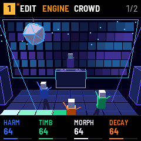

# Noise: CROWD, STATIC, GLITTER

[← Manual](index.html#s6)

The noise family makes sounds without a clear single pitch: swarms, filtered hiss and crackle. The note still matters:
it tunes the swarm or the filter, so play high for hiss and low for rumble. None of the three makes its own envelope:
ENV's ADSR shapes their level.

The values below were measured with the two other knobs at 64, on C3 unless said otherwise. A change below 300 Hz is
clear on headphones and faint on the FM-1's speaker.

A neon dancefloor whose tiles the grains light, a DJ before an LED wall, three dancers and a mirror ball: HARM, TIMB
and MORPH change the grains (a swarm for CROWD, snow for STATIC, sparks for GLITTER), and DECAY how long the dancers'
arms stay up.

## CROWD

**Sound.** Eight sawtooths in a swarm, each wandering around the note: thick, chorused, unstable. Huge pads and drones.

| Knob | At 0 | Middle | At 127 |
| --- | --- | --- | --- |
| HARM, the pitch spread | The saws close together | Spread | Spread wide: more energy up high |
| TIMB, the density | Sparse: the low end dominates | Denser | Dense: more energy in the mids |
| MORPH, the grain duration | Short grains: very quiet | Longer | Long grains: the loudest |

**Start with** MORPH at 64 or above: below, the swarm gets very quiet.

**Recipes**

| Sound | Settings |
| --- | --- |
| Drone | Low notes (C2), TIMB 127: thick, its energy below 150 Hz |
| Detuned pad | HARM 100, TIMB 64, MORPH 100, POLY 2, a slow ENV ATTACK |

## STATIC

**Sound.** Noise clocked and filtered: the note sets the filter's frequency, so the noise is pitched. Hi-hats, wind,
risers.

| Knob | At 0 | Middle | At 127 |
| --- | --- | --- | --- |
| HARM, low-pass to high-pass | Low-pass: the rumble below the note | Band-pass: around the note | High-pass: the noise above the note |
| TIMB, the clock | Very slow: almost silent | The noise at full rate | Fast: a little brighter, quieter |
| MORPH, the resonance | Less resonant | — | Resonant: a whistle on the note |

**Start with** a high note (C5 or above) and HARM at 64: the noise sits around the note.

**Recipes**

| Sound | Settings |
| --- | --- |
| Wind | A high note held, MORPH 127, an LFO on HARM (DEPTH 30, DEST HARM, a slow RATE) |
| Noise hat | A high note, HARM 127, ENV with SUSTAIN 0 and a short DECAY |

## GLITTER

**Sound.** Dust, random clicks through resonators: crackle, rain, vinyl. The note tunes the resonators.

| Knob | At 0 | Middle | At 127 |
| --- | --- | --- | --- |
| HARM, the frequency spread | Every click rings on the note | Clicks scattered around it | Scattered wide, at random |
| TIMB, the density | Sparse clicks: quiet | More | A dense crackle: much louder |
| MORPH, the filter | Loud, the low end | Quietest | Narrower |

**Start with** a note around C5 and TIMB at 100: sparse clicks are quiet.

**Recipes**

| Sound | Settings |
| --- | --- |
| Rain | A note around C5, TIMB 127, MORPH 0, a long ENV RELEASE |
| Vinyl crackle | Low notes, TIMB 40, MORPH 127, a note held under the track |

**Inspired by** [Plaits](https://pichenettes.github.io/mutable-instruments-documentation/modules/plaits/manual/) by
Mutable Instruments, whose swarm, filtered noise and particle noise models these are.

---

[← Voice](synth-voice.html) · [Physical →](synth-physical.html)
