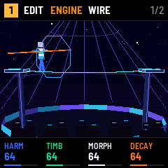
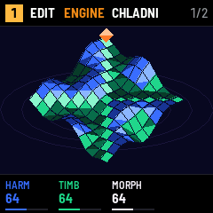

# Physical: WIRE, CHLADNI

[← Manual](index.html#s6)

The physical family models a struck or plucked object and lets it ring: strings, marimbas, bells, metal. Both models
make their own envelope: ENV's ADSR then shapes only the filter, and DECAY sets how long the object rings.

The values below were measured on the note C3 with the two other knobs at 64. A change below 300 Hz is clear on
headphones and faint on the FM-1's speaker.

WIRE has an acrobat on a laser rope that hops and plucks the rope on each note: HARM sets the rope's stiffness, TIMB
its brightness and MORPH its damping. CHLADNI draws a Chladni figure of the body's modes: HARM picks the mode, TIMB the
strike's force and MORPH its damping.

## WIRE

**Sound.** A plucked string, from a clean guitar-like pluck to a stiff, inharmonic wire that sounds like metal.

| Knob | At 0 | Middle | At 127 |
| --- | --- | --- | --- |
| HARM, inharmonicity | A harmonic string | Stiffer | Inharmonic: metallic |
| TIMB, the brightness | Dark: most of the energy below 150 Hz, quiet | Brighter | Bright: around 600 Hz–2.4 kHz, louder |
| MORPH, the decay | Short and dark | — | Long and bright |

**Start with** TIMB at 100: lower, the pluck is dark and quiet.

**Recipes**

| Sound | Settings |
| --- | --- |
| Plucked bass | Low notes, HARM 0, TIMB 100, MORPH 30 |
| Metal bell | Notes around C4, HARM 127, TIMB 100, MORPH 110: spread from 600 Hz to above 4.8 kHz |

## CHLADNI

**Sound.** A struck resonant body: marimba, vibraphone, bells, metal plates. HARM picks the material, from wood to
metal.

| Knob | At 0 | Middle | At 127 |
| --- | --- | --- | --- |
| HARM, the material | Wood: most of the energy around 1 kHz | Between | Metal: brighter, up to 4.8 kHz |
| TIMB, the strike's brightness | Soft mallet: low | Harder | A hard strike: bright, around 1.2–4.8 kHz |
| MORPH, the decay | Short: quiet | — | Long: rings, louder |

**Start with** HARM at 0 for wood, then raise it.

**Recipes**

| Sound | Settings |
| --- | --- |
| Marimba | Notes around C4, HARM 0, TIMB 40, MORPH 30 |
| Bell | Notes around C4, HARM 127, TIMB 127, MORPH 127: most of the energy above 2.4 kHz |

**Inspired by** [Plaits](https://pichenettes.github.io/mutable-instruments-documentation/modules/plaits/manual/) by
Mutable Instruments, whose inharmonic string and modal resonator models these are; CHLADNI's scene after
[Chladni figures](https://en.wikipedia.org/wiki/Ernst_Chladni#Chladni_figures).
