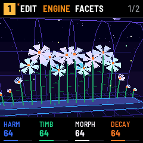

# Spectral: FACETS, POLLEN

[← Manual](index.html#s6) · [All pages](index.html#pages)

The spectral family builds its sound from where the energy sits in the spectrum: FACETS stacks harmonics around a
peak, POLLEN shapes formants like a voice or a resonant tube. TIMB moves the peak; it is the knob to play. Neither
model makes its own envelope: ENV's ADSR shapes their level.

The values below were measured on the note C3 with the two other knobs at 64. A change below 300 Hz is clear on
headphones and faint on the FM-1's speaker.

A garden of crystal flowers, one per harmonic, as tall and as open as the spectrum: HARM, TIMB and MORPH reshape the
garden as they reshape the sound, and DECAY sets how long the flowers' hearts glow after a note.

## FACETS

**Sound.** Additive synthesis: sine harmonics added up, the loudest ones grouped in bumps around a main harmonic. Pure,
organ-like and whistling tones.

| Knob | At 0 | Middle | At 127 |
| --- | --- | --- | --- |
| HARM, the bumps | One narrow bump: almost a single harmonic | The same, a little wider | Several bumps: spread over two octaves |
| TIMB, the main harmonic | Low: around 300–600 Hz | Around 1.2–2.4 kHz | High: a whistle at 2.4–4.8 kHz |
| MORPH, the bumps' shape | Quieter, a little wider | — | Louder and narrower |

**Start with** TIMB at 20: lower in the spectrum, it is easier on the ear.

**Recipes**

| Sound | Settings |
| --- | --- |
| Flute-like tone | HARM 30, TIMB 20, MORPH 64: nearly all the energy in one band |
| Wider tone | HARM 127, TIMB 64: the energy over two octaves instead of one |
| High whistle | Notes around C4, TIMB 110: piercing, keep the level down |

## POLLEN

**Sound.** Granular formants: sine segments shaped into two formants, the resonances that make a vowel. Vocal,
tube-like and nasal tones.

| Knob | At 0 | Middle | At 127 |
| --- | --- | --- | --- |
| HARM, the second formant's ratio | Close to the first: a darker vowel | Apart | Far up: a bright second peak around 1.2–2.4 kHz |
| TIMB, the first formant | Very low and quiet | Around 300–600 Hz: a vowel | Very high, 2.4–4.8 kHz: a whistle |
| MORPH, width and shape | Narrow: much quieter | The loudest | Narrow again: much quieter |

**Start with** MORPH at 64: at either end the sound gets very quiet.

**Recipes**

| Sound | Settings |
| --- | --- |
| Vowel | HARM 64, TIMB 50, MORPH 64 |
| Talking sweep | A note held, an LFO on TIMB (DEPTH 30, DEST TIMB) |
| Bright formant lead | Notes around C4, HARM 100, TIMB 100 |

**Inspired by** [Plaits](https://pichenettes.github.io/mutable-instruments-documentation/modules/plaits/manual/) by
Mutable Instruments, whose additive and granular formant models these are.

---

[← Tables](synth-tables.html) · [Chords →](synth-chords.html)
