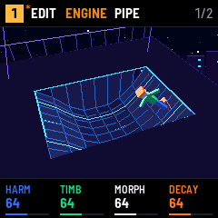
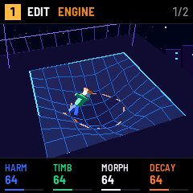

# Tables: PIPE, BOWL

[← Manual](index.html#s6) · [All pages](index.html#pages)

The tables family plays stored waveforms and travels through them: TIMB and MORPH move from one wave to the next, so
turning them, or putting an LFO on them, makes the sound evolve while a note holds. Good for pads, textures and
digital leads. Neither model makes its own envelope: ENV's ADSR shapes their level.

The values below were measured on the note C3 with the two other knobs at 64. A change below 300 Hz is clear on
headphones and faint on the FM-1's speaker.

A rider on a hoverboard: in PIPE, a half-pipe whose walls carry the wave played; in BOWL, a bowl shaped by the
terrain, ridden round the circle the sound reads. HARM, TIMB and MORPH reshape the wave or the terrain, and DECAY the
rider's trail.

## PIPE

**Sound.** Wavetables: 4 banks of 8 × 8 waves. HARM picks the bank, TIMB the row and MORPH the column, and the sound
glides smoothly between neighbouring waves.

| Knob | At 0 | Middle | At 127 |
| --- | --- | --- | --- |
| HARM, the bank | Thin and quiet, around 1 kHz | Fuller, with more low end | Thin again, brighter |
| TIMB, the row | A rounder wave, around 300–600 Hz | A mix of low and mid | A brighter, quieter wave |
| MORPH, the column | Bright, most of the energy at 2.4–4.8 kHz | A mix of low and mid | Mid only, around 1 kHz |

**Start with** HARM at 32 or 96 for two quite different banks, then sweep MORPH.

**Recipes**

| Sound | Settings |
| --- | --- |
| Soft pad | TIMB 0, MORPH 127, POLY 3, a slow ENV ATTACK |
| Moving texture | A note held, an LFO on MORPH (DEPTH 40, DEST MORPH, a slow RATE) |
| Digital lead | HARM 96, TIMB 64, MORPH 0 |

## BOWL

**Sound.** Wave terrain: a 2D landscape read along a circle. HARM picks the terrain, TIMB the circle's radius and
MORPH where it sits. A small circle is close to a sine; a large one crosses more of the landscape and gets richer.

| Knob | At 0 | Middle | At 127 |
| --- | --- | --- | --- |
| HARM, the terrain | A smooth terrain: mostly 300–600 Hz | Richer | A rugged terrain: bright, most of the energy at 2.4–4.8 kHz |
| TIMB, the radius | A small circle: deep and round | Richer | A large circle: the body moves up |
| MORPH, the offset | Fuller and louder | — | Quieter |

**Start with** TIMB at 0 for a round tone, then open it.

**Recipes**

| Sound | Settings |
| --- | --- |
| Deep bass | Low notes (C2), HARM 0, TIMB 0: its energy below 150 Hz |
| Glass | Notes around C4, HARM 127, TIMB 64: most of the energy far up, above 4.8 kHz |

**Inspired by** [Plaits](https://pichenettes.github.io/mutable-instruments-documentation/modules/plaits/manual/) by
Mutable Instruments, whose wavetable and wave terrain (firmware 1.2) models these are.

---

[← FM](synth-fm.html) · [Spectral →](synth-spectral.html)
