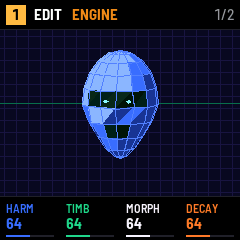

# Voice: ORATOR

[← Manual](index.html#s6)

The voice family has one model, ORATOR: a speech synthesizer that sings vowels and says words in time with the
notes. It does not make its own envelope: ENV's ADSR shapes its level.

The values below were measured on the note C3 with the two other knobs at 64. A change below 300 Hz is clear on
headphones and faint on the FM-1's speaker.

A low-poly head that speaks: HARM tints it with the voice model, TIMB sets its size and MORPH opens its mouth on the
phoneme; DECAY sets how long its syllables show.

## ORATOR

**Sound.** Robotic vowels and words. HARM has two halves:

- **0 to 42** blends three speech synthesizers, a formant filter, SAM (an early home-computer voice) and LPC (the voice
  of speaking toys); MORPH then glides from vowel to vowel;
- **from 43**, each detent picks a bank: PHONEMES, then WORDS 1 to 5, and the footer shows its name; MORPH then picks
  the phoneme or the word, and each note says it.

| Knob | At 0 | Middle | At 127 |
| --- | --- | --- | --- |
| HARM, the voice or the bank | The formant voice: low, most of the energy at 150–300 Hz | A word bank: brighter, spread | The last word bank |
| TIMB, the voice's size | A giant: deep and quiet | A person | A tiny voice: high, above 600 Hz |
| MORPH, the vowel, phoneme or word | The first one | — | The last one |

**Start with** HARM at 20 and turn MORPH slowly while a note holds: the vowels go by.

**Recipes**

| Sound | Settings |
| --- | --- |
| Singing vowels | HARM 20, a note held, an LFO on MORPH (DEPTH 40, DEST MORPH) |
| Talking pattern | HARM on WORDS 1, a pattern of short notes, MORPH set on a word |
| Deep voice | Low notes (C2), HARM 0, TIMB 64: its energy at 150–300 Hz |

**Inspired by** [Plaits](https://pichenettes.github.io/mutable-instruments-documentation/modules/plaits/manual/) by
Mutable Instruments, whose speech model this is.
